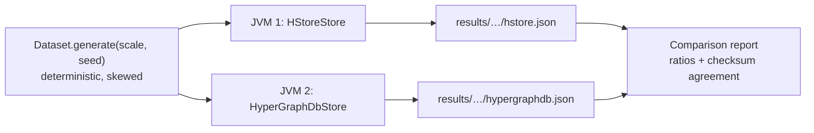

# Benchmarks: HStore and HyperGraphDB

This page compares HStore with [HyperGraphDB](https://github.com/hypergraphdb/hypergraphdb), the established
Java hypergraph database. Both run the same workloads on the same deterministic dataset in separate JVMs. Every
read workload is cross-checked: the two engines must return identical answers, as the "Results agree" column
shows. The harness lives in [`benchmarks/`](../benchmarks) and can be rerun on any machine.



## Setup

| | HStore | HyperGraphDB |
|---|---|---|
| Version | 0.1.0 (this repository) | 1.4 at commit `99485a1`, storage `bdb-je` on Berkeley DB JE 5.0.73 |
| Data model used | node type `Entity` (indexed by key, property `name`); `SET_EDGE` type `Relation` | `String` atoms; `HGPlainLink` links |
| Cache | node cache of half the heap, or `CACHE_MB` | JE cache at 30% of the heap (HyperGraphDB default), or `CACHE_MB`, plus the HyperGraphDB atom cache |
| `async` durability | `durability = async` | HyperGraphDB default: JE `WRITE_NO_SYNC` |
| `sync` durability | `durability = sync`, `wal_mode = references`, group commit | JE `COMMIT_SYNC`, and `Environment.flushLog(true)` after every commit (see below) |
| History | `history_limit = 64` generations retained for time travel (default) | none |

Each run used a 4 GiB heap and `-XX:+UseParallelGC` on Oracle GraalVM for JDK 25.0.4 (HotSpot JIT), on an Apple
M5 (4 performance and 6 efficiency cores) with 24 GiB of memory and an internal SSD, running macOS 26.5.1.

**Synchronous commits in HyperGraphDB.** HyperGraphDB 1.4 begins every JE transaction with an explicit
`WRITE_NO_SYNC` durability, which overrides the environment's `COMMIT_SYNC`. Setting the environment alone
leaves its commits unsynced: single-update commits took about 0.1 ms, while one forced write on the machine
above takes about 3.8 ms. In `sync` mode the adapter therefore calls `Environment.flushLog(true)` after every
commit, which writes and forces JE's log as `COMMIT_SYNC` would. Results for `sync` published before this
change measured HyperGraphDB without any sync.

**Dataset.** At scale *s*: 50,000·*s* nodes and 100,000·*s* hyperedges. Cardinality follows a geometric tail
starting at 2 (continue with probability 0.62, capped at 32), for a mean of 3.6. Members are drawn as
`⌊n · u^2.2⌋` for uniform `u`, so low-numbered nodes become hubs with large incidence sets, as in real
co-authorship, claims or citation data. Probe sets are 100,000 random nodes and hyperedges, 20,000 node pairs
taken from a common hyperedge (so co-membership counts are non-zero), and 20,000 updates. The seed is fixed
(`20260904`).

**Workloads.**

| Id | Operation | HStore API | HyperGraphDB API |
|---|---|---|---|
| `ingest.nodes` | insert nodes, 1,000 per transaction | `Writer.node` | `graph.add(String)` in `transact` |
| `ingest.edges` | insert hyperedges, 1,000 per transaction | `Writer.edge` + `Writer.load` | `graph.add(new HGPlainLink(…))` |
| `read.incidence` | enumerate a node's incidence set, 1,000 probes per read transaction | `Reader.forEachIncidentEdge` | `getIncidenceSet(h).getSearchResult()` |
| `read.members` | enumerate a hyperedge's members | `Reader.forEachMemberId` | `HGLink.getTargetAt` over `graph.get(h)` |
| `read.comembership` | count hyperedges containing both nodes of a pair | `TreeAlgebra.intersectKeys` (leapfrog) | `hg.count(hg.and(hg.incident(a), hg.incident(b)))` |
| `read.twohop` | count the distinct nodes that share a hyperedge with a node, 10,000 probes | `Reader.forEachIncidentEdge` + `Reader.forEachMemberId` | `getIncidenceSet` + the link's targets |
| `read.incidence.parallel` | `read.incidence` from one thread per core | same | same |
| `latency.read` | one incidence lookup per read transaction, each timed on its own | `Reader.forEachIncidentEdge` | `getIncidenceSet(h).getSearchResult()` |
| `write.update` | replace a node's value, 1,000 per transaction | `Writer.set` | `graph.replace` |
| `latency.commit` | 5,000 write transactions of one update each, each timed on its own | `Writer.set` | `graph.replace` |
| `mixed.read` | single incidence lookups from `threads − 1` threads for 10 s while `mixed.write` runs | `Reader.forEachIncidentEdge` | `getIncidenceSet(h).getSearchResult()` |
| `mixed.write` | one thread committing 10 updates at a time on a fixed schedule of 1,000 updates/s | `Writer.set` | `graph.replace` |
| `large.ingest` | one hyperedge containing every node | `Writer.load` | one `HGPlainLink` |
| `large.scan` | enumerate the large hyperedge 400 times, after the warm-up described below | `Reader.forEachMemberId` | `getTargetAt` loop |
| `large.probe` | test whether a node belongs to the large hyperedge | `View.incidence(edge, node)` (membership-tree lookup) | `getIncidenceSet(node).contains(edge)` |
| `reopen` | close and reopen, including recovery | `HypergraphDatabase.open` | `HGEnvironment.get` |
| `read.incidence.cold` | `read.incidence` immediately after reopening | | |
| `disk` | bytes on disk after a clean shutdown | | |
| `churn.delete` | delete 20% of the hyperedges, 1,000 per transaction | `Writer.delete` | `graph.remove` |
| `churn.remove` | remove one member from each of 20,000 other hyperedges, 1,000 per transaction | `Writer.remove` | `graph.replace` with a new `HGPlainLink` (links are immutable) |
| `read.incidence.churned` | `read.incidence` after the deletes | | |
| `disk.churned` | bytes on disk after the deletes and a clean shutdown | | |
| `compaction.baseline` | single-update commits at 50/s for 10 s, no compaction | `Writer.set` | `graph.replace` |
| `compaction` | the same commits while a full compaction runs, starting 1 s in | `StorageEngine.compact` | `Environment.cleanLog` until it finds nothing, then a forced checkpoint |
| `disk.compacted` | bytes on disk after the compaction and a clean shutdown | | |
| `recover` | open the store after the process ingesting into it was killed with SIGKILL | `HypergraphDatabase.open` | `HGEnvironment.get` |

Read workloads, `large.scan` and `latency.read` first repeat the whole workload for at least 2 seconds without
timing it. The exception is `read.incidence.cold`. Both engines get the same warm-up. The numbers describe a server that has been running for
a while, not one that has just started. With a warm-up over 10% of the probes, as earlier versions of this
benchmark did, most of the timed pass still ran before the JIT had compiled the read path. The timings mostly
showed how quickly each engine's code got compiled, and `read.members` came out about three times lower for
HStore than its steady rate.

The two `latency.*` workloads time every operation separately with `System.nanoTime()`. Each operation is a whole
transaction, as it would be for a request to a server. The report adds a second table with p50, p99, p99.9 and the
maximum, taking the median of each percentile across runs. Throughput hides occasional slow operations caused by
group commit, checkpoints, compaction or GC; these percentiles show them. Under `sync` durability,
`latency.commit` is effectively the cost of one durable commit.

**Reads during writes.** In `mixed`, the readers run in a closed loop for 10 s, and a single writer commits on a
fixed schedule (open loop). Each commit's latency is measured from when it was *scheduled* to start, not from
when it actually started. If the engine stalls, the commits queued behind the stall show the delay, instead of
the writer quietly slowing down. The writer stops at the deadline even when it is behind, so an engine that can't
keep up shows an achieved rate below 1,000 updates/s. Readers keep a uniform random sample of 200,000 latencies
each, plus the exact maximum. Both results depend on timing, so *Results agree* shows "n/a".

**Two hops.** `read.twohop` follows each probe node to its hyperedges and from there to their members. It runs
before `large.ingest`, because once the hyperedge containing every node exists, every node is two hops from all
the others. Each adapter uses plain incidence and member calls and its own id type: `long` ids, sorted and
de-duplicated, for HStore, and a `HashSet` of persistent handles for HyperGraphDB, which has no numeric ids.
HyperGraphDB's `HGBreadthFirstTraversal` isn't used, since it would measure that framework rather than the
storage underneath.

**Deletes.** The churn set is drawn from the same seed after everything else, so the rest of the dataset is
unchanged. It has 20% of the hyperedges to delete and 20,000 others, each with at least three members, that lose
one member. `disk` is recorded while the store is closed for a reopen, before the churn starts, so it still means
the loaded store after a clean shutdown. The checksum of `read.incidence.churned` has to agree, which confirms
both engines applied the same deletes. `disk.churned` shows whether the space came back: through compaction for
HStore, and the log cleaner for JE.

**Compaction.** After the churn, `disk.churned` is recorded at a reopen, and then two 10 s windows run. In both, one
writer commits a single update every 20 ms on a fixed schedule, and each commit's latency is measured from when it
was scheduled. In `compaction`, the store also runs a full compaction starting 1 s in, and the window lasts until
the compaction has finished. HStore calls `StorageEngine.compact()`. JE calls `cleanLog()` until it cleans nothing,
then forces a checkpoint so the cleaned files are deleted. The latency table compares the two windows, and the
*Resources* table adds the compaction time and the space reclaimed. Disk is measured at a reopen just before the
window and again at a reopen just after it, so segments that HStore only deletes once older readers are gone are
counted too. That figure can be negative when compaction frees less than the writer adds. The two windows run at a
fixed rate, so they are left out of the main table, where their ratio would always be about 1. HStore's default segments are 256 MiB, so
at scale 1 most data shares one or two segments. `--pages-per-segment` (`PAGES_PER_SEGMENT`) and
`--compaction-live-ratio` (`COMPACTION_LIVE_RATIO`) change HStore's settings for a run.

**Crash recovery.** `reopen` closes the store cleanly first. `recover` doesn't:
1. The run starts a second JVM (`Comparison crash`) with the same flags and classpath. It ingests nodes into a
   fresh directory and prints the count after every acknowledged commit.
2. Once half the nodes are acknowledged, the parent kills it with SIGKILL.
3. The parent times opening the directory, then counts the nodes that survived.

The *Resources* table shows how many acknowledged nodes were lost, including when it's zero. SIGKILL is a process
crash, not a power failure: bytes the engine handed to the operating system survive it even without an fsync. So
this measures recovery time and the engine's own buffering, not whether `sync` really reaches the disk. Torn
writes and lost fsyncs are covered by HStore's crash matrix (`CrashRecoveryTest`, see [development.md](development.md)), not by this
benchmark.

**Bytes written.** For every write workload the report also shows the bytes each engine wrote per operation, in a
*Resources* table, plus the total for the whole run. Both engines count the bytes they write themselves:

| HStore | HyperGraphDB |
|---|---|
| WAL bytes plus page bytes (`EngineStats.walBytes + dataBytesWritten`), including pages moved by compaction | sequential plus random write bytes from JE's `EnvironmentStats`, including the log cleaner |

Each write workload ends with a flush (an HStore checkpoint, `Environment.sync()` for JE) after its timed section,
so bytes still sitting in buffers are counted against the workload that produced them. The counters restart
when a store reopens, so the adapters carry the total across `reopen`. Bytes written during the final close
aren't counted.

**Amplification.** The *Resources* table also divides physical bytes by an estimate of the logical bytes involved:

| Ratio | Physical bytes | Logical bytes |
|---|---|---|
| write amplification | bytes written (above) | 8 bytes per id plus the value: `node-<i>` for a new node, 24 bytes for an updated value, `(cardinality + 1) × 8` for a new or deleted hyperedge, 16 bytes for a removed member |
| read amplification | bytes read from storage | 8 bytes per id the workload returned (its checksum counts them) |

HStore counts the bytes it reads from segment files (`EngineStats.dataBytesRead`): a first read of up to 4 KiB,
then the rest of the page image if it's bigger. JE reports sequential plus random read bytes. Reads served from a cache read nothing from storage, so read amplification mostly shows up for
cold reads and with a small `CACHE_MB`. The logical sizes are rough estimates; compare the two stores against each
other rather than reading the ratios as absolute numbers.

**Memory.** Every workload also records, from the JVM's own MXBeans, the bytes allocated
(`getTotalThreadAllocatedBytes` for the whole process; for the single-threaded read workloads, only the reading
thread's `getCurrentThreadAllocatedBytes`, so background maintenance doesn't count against a read) and the GC pause time (`GarbageCollectorMXBean.getCollectionTime`, which is
stop-the-world time with ParallelGC). Rows where both stores paused for 0 ms are left out. After ingest, the run
forces a full GC and records how much heap the loaded store keeps. A baseline taken before the store opens is
subtracted, so the shared dataset arrays don't count. This number mostly reflects how each engine's cache is
configured (see *Setup*).

## Results

These results come from HStore at commit `459b8be`, on the machine described in *Setup*, with both caches set to
64 MiB (`CACHE_MB=64`) and `THREADS=8`. Scale 1 ran 5 times per store in each durability mode, and scale 4 ran 3
times. Each cell is the median, with the slowest and fastest run in brackets. The machine was running other
work: sampled before each run, the one-minute load average was between 4.4 and 16.7 on 10 cores. Where the
bracketed ranges of the two stores overlap, treat the ratio as a tendency rather than a measured difference.

The [benchmark report](benchmark-report.pdf) has the full method, every table for all three configurations
(latency, bytes written, heap and GC), the value of every run, and the discussion. Its raw results, and the
script that builds its tables, are in [`benchmarks/report`](../benchmarks/report).

Ratios above 1 favour HStore. Throughput ratios divide HStore by HyperGraphDB; latency and size ratios divide
HyperGraphDB by HStore.

### Scale 1, `async` durability

Dataset: 50,000 nodes, 100,000 hyperedges, 362,757 incidences; durability async; 8 threads.

| Workload | HStore | HyperGraphDB | Ratio of medians | Results agree |
|---|---:|---:|---:|:---:|
| `ingest.nodes`: insert nodes in transactions of 1,000 | 45,124 ops/s (32,919 to 66,106) | 24,930 ops/s (11,229 to 33,032) | **1.81×** | yes |
| `ingest.edges`: insert hyperedges (mean cardinality 3.6) in transactions of 1,000 | 28,198 ops/s (22,543 to 37,283) | 22,500 ops/s (11,053 to 35,992) | **1.25×** | yes |
| `read.incidence`: enumerate the incidence set of a node | 7,472,143 ops/s (3,997,182 to 7,630,311) | 739,484 ops/s (221,944 to 927,800) | **10.10×** | yes |
| `read.members`: enumerate the members of a hyperedge | 3,694,075 ops/s (1,529,065 to 5,202,587) | 1,702,172 ops/s (482,769 to 2,220,779) | **2.17×** | yes |
| `read.comembership`: count hyperedges containing both atoms of a pair | 447,789 ops/s (127,231 to 651,937) | 32,538 ops/s (18,486 to 54,813) | **13.76×** | yes |
| `read.twohop`: count the distinct nodes that share a hyperedge with a node | 301,232 ops/s (240,766 to 347,622) | 74,579 ops/s (18,598 to 130,603) | **4.04×** | yes |
| `read.incidence.parallel`: incidence sets from 8 threads, 100,000 probes each | 24,439,172 ops/s (17,134,244 to 34,798,935) | 1,691,919 ops/s (637,312 to 2,175,513) | **14.44×** | yes |
| `latency.read`: one incidence lookup per read transaction | 2,809,235 ops/s (1,970,735 to 3,462,394) | 269,377 ops/s (106,860 to 337,642) | **10.43×** | yes |
| `write.update`: replace a node value in transactions of 1,000 | 78,091 ops/s (53,208 to 82,882) | 5,111 ops/s (2,905 to 8,739) | **15.28×** | yes |
| `latency.commit`: one node update per write transaction | 7,865 ops/s (5,340 to 13,622) | 5,798 ops/s (4,560 to 9,591) | **1.36×** | yes |
| `mixed.read`: single incidence lookups from 7 readers while one writer commits 10 updates at a time, targeting 1,000 updates/s | 1,872,082 ops/s (1,782,768 to 2,529,519) | 761,958 ops/s (316,836 to 1,021,256) | **2.46×** | n/a |
| `mixed.write`: updates committed by the writer alongside the readers | 1,000 ops/s (996 to 1,000) | 1,000 ops/s (795 to 1,000) | **1.00×** | n/a |
| `large.ingest`: create one hyperedge with 50,000 members | 439,642 ops/s (261,929 to 480,878) | 35,654 ops/s (13,771 to 54,078) | **12.33×** | yes |
| `large.scan`: enumerate all members of the large hyperedge (x400, after a warm-up) | 2,259,599,768 ops/s (1,700,065,878 to 3,729,893,079) | 610,672,274 ops/s (308,735,077 to 1,170,263,579) | **3.70×** | yes |
| `large.probe`: test whether a node belongs to the large hyperedge | 15,623,882 ops/s (2,535,875 to 19,290,897) | 771,891 ops/s (251,952 to 1,073,301) | **20.24×** | yes |
| `reopen`: close and reopen the database, including recovery | 121 ms (116 to 373) | 1,369 ms (940 to 2,088) | **11.31×** | yes |
| `read.incidence.cold`: incidence sets immediately after reopening | 2,761,318 ops/s (277,983 to 3,026,066) | 41,898 ops/s (15,486 to 55,249) | **65.91×** | yes |
| `disk`: bytes on disk after a clean shutdown | 91.2 MiB (91.1 to 93.2) | 432.2 MiB (374.2 to 535.2) | **4.74×** | yes |
| `churn.delete`: delete 20,000 hyperedges (20%) in transactions of 1,000 | 16,291 ops/s (6,055 to 20,524) | 2,986 ops/s (1,565 to 6,388) | **5.46×** | yes |
| `churn.remove`: remove one member from each of 20,000 other hyperedges, 1,000 per transaction | 24,365 ops/s (14,469 to 33,208) | 8,119 ops/s (5,676 to 15,599) | **3.00×** | yes |
| `read.incidence.churned`: enumerate incidence sets after the deletes | 6,888,001 ops/s (2,626,571 to 7,491,198) | 1,107,018 ops/s (785,085 to 2,403,497) | **6.22×** | yes |
| `disk.churned`: bytes on disk after the deletes and a clean shutdown | 119.8 MiB (115.9 to 129.7) | 293.3 MiB (261.2 to 348.9) | **2.45×** | yes |
| `disk.compacted`: bytes on disk after a full compaction and a clean shutdown | 90.8 MiB (90.8 to 90.8) | 273.5 MiB (204.0 to 290.7) | **3.01×** | yes |
| `recover`: open the store after killing the ingest process with SIGKILL | 128 ms (107 to 356) | 132 ms (82 to 157) | **1.03×** | n/a |

Latency of single operations, median of each percentile across runs:

| Workload | Percentile | HStore | HyperGraphDB | Ratio |
|---|---|---:|---:|---:|
| `latency.read` | p50 | 0.3 µs | 1.6 µs | **4.76×** |
| `latency.read` | p99 | 1.2 µs | 26.3 µs | **22.53×** |
| `latency.read` | p99.9 | 5.2 µs | 207.0 µs | **40.05×** |
| `latency.read` | max | 57.8 µs | 7.29 ms | **126.09×** |
| `latency.commit` | p50 | 85.1 µs | 91.5 µs | **1.07×** |
| `latency.commit` | p99 | 429.6 µs | 1.08 ms | **2.52×** |
| `latency.commit` | p99.9 | 1.62 ms | 5.02 ms | **3.09×** |
| `latency.commit` | max | 8.79 ms | 25.56 ms | **2.91×** |
| `mixed.read` | p50 | 1.6 µs | 2.9 µs | **1.77×** |
| `mixed.read` | p99 | 12.7 µs | 73.6 µs | **5.81×** |
| `mixed.read` | p99.9 | 57.4 µs | 1.03 ms | **17.93×** |
| `mixed.read` | max | 51.62 ms | 87.42 ms | **1.69×** |
| `mixed.write` | p50 | 3.09 ms | 4.85 ms | **1.57×** |
| `mixed.write` | p99 | 16.70 ms | 80.12 ms | **4.80×** |
| `mixed.write` | p99.9 | 46.96 ms | 110.43 ms | **2.35×** |
| `mixed.write` | max | 46.96 ms | 110.43 ms | **2.35×** |
| `compaction.baseline` | p50 | 5.06 ms | 4.87 ms | **0.96×** |
| `compaction.baseline` | p99 | 9.63 ms | 27.99 ms | **2.91×** |
| `compaction.baseline` | p99.9 | 10.60 ms | 52.86 ms | **4.99×** |
| `compaction.baseline` | max | 10.60 ms | 52.86 ms | **4.99×** |
| `compaction` | p50 | 5.15 ms | 5.11 ms | **0.99×** |
| `compaction` | p99 | 9.39 ms | 13.32 ms | **1.42×** |
| `compaction` | p99.9 | 16.03 ms | 33.70 ms | **2.10×** |
| `compaction` | max | 16.03 ms | 33.70 ms | **2.10×** |

### Scale 1, `sync` durability

Dataset: 50,000 nodes, 100,000 hyperedges, 362,757 incidences; durability sync; 8 threads.

| Workload | HStore | HyperGraphDB | Ratio of medians | Results agree |
|---|---:|---:|---:|:---:|
| `ingest.nodes`: insert nodes in transactions of 1,000 | 29,660 ops/s (22,199 to 31,465) | 12,627 ops/s (9,260 to 15,596) | **2.35×** | yes |
| `ingest.edges`: insert hyperedges (mean cardinality 3.6) in transactions of 1,000 | 19,884 ops/s (5,121 to 25,199) | 16,377 ops/s (11,336 to 19,379) | **1.21×** | yes |
| `read.incidence`: enumerate the incidence set of a node | 3,662,400 ops/s (722,841 to 4,402,272) | 384,637 ops/s (202,508 to 541,974) | **9.52×** | yes |
| `read.members`: enumerate the members of a hyperedge | 2,553,373 ops/s (1,283,576 to 2,708,706) | 1,176,098 ops/s (605,219 to 1,606,077) | **2.17×** | yes |
| `read.comembership`: count hyperedges containing both atoms of a pair | 268,955 ops/s (73,128 to 359,769) | 9,264 ops/s (6,602 to 22,363) | **29.03×** | yes |
| `read.twohop`: count the distinct nodes that share a hyperedge with a node | 174,383 ops/s (112,165 to 239,400) | 38,159 ops/s (14,753 to 62,344) | **4.57×** | yes |
| `read.incidence.parallel`: incidence sets from 8 threads, 100,000 probes each | 7,889,212 ops/s (3,865,167 to 17,032,178) | 942,062 ops/s (626,685 to 1,698,089) | **8.37×** | yes |
| `latency.read`: one incidence lookup per read transaction | 1,807,100 ops/s (601,842 to 2,270,977) | 222,231 ops/s (170,393 to 251,137) | **8.13×** | yes |
| `write.update`: replace a node value in transactions of 1,000 | 40,288 ops/s (6,028 to 50,806) | 3,600 ops/s (2,741 to 4,556) | **11.19×** | yes |
| `latency.commit`: one node update per write transaction | 250 ops/s (238 to 255) | 203 ops/s (160 to 216) | **1.23×** | yes |
| `mixed.read`: single incidence lookups from 7 readers while one writer commits 10 updates at a time, targeting 1,000 updates/s | 1,583,174 ops/s (1,248,493 to 1,633,918) | 623,680 ops/s (528,806 to 731,169) | **2.54×** | n/a |
| `mixed.write`: updates committed by the writer alongside the readers | 1,000 ops/s (999 to 1,000) | 973 ops/s (937 to 1,000) | **1.03×** | n/a |
| `large.ingest`: create one hyperedge with 50,000 members | 264,836 ops/s (100,131 to 348,720) | 28,912 ops/s (18,611 to 59,305) | **9.16×** | yes |
| `large.scan`: enumerate all members of the large hyperedge (x400, after a warm-up) | 1,793,205,884 ops/s (1,362,030,591 to 2,533,074,993) | 401,183,491 ops/s (209,074,988 to 495,719,770) | **4.47×** | yes |
| `large.probe`: test whether a node belongs to the large hyperedge | 9,596,123 ops/s (7,711,041 to 10,334,359) | 867,374 ops/s (123,150 to 1,185,144) | **11.06×** | yes |
| `reopen`: close and reopen the database, including recovery | 165 ms (146 to 166) | 1,274 ms (1,016 to 2,417) | **7.73×** | yes |
| `read.incidence.cold`: incidence sets immediately after reopening | 1,920,287 ops/s (1,498,046 to 2,097,403) | 35,738 ops/s (19,627 to 47,057) | **53.73×** | yes |
| `disk`: bytes on disk after a clean shutdown | 91.2 MiB (90.7 to 92.7) | 350.9 MiB (341.1 to 429.2) | **3.85×** | yes |
| `churn.delete`: delete 20,000 hyperedges (20%) in transactions of 1,000 | 10,529 ops/s (7,705 to 14,811) | 2,326 ops/s (2,045 to 3,494) | **4.53×** | yes |
| `churn.remove`: remove one member from each of 20,000 other hyperedges, 1,000 per transaction | 21,722 ops/s (7,640 to 26,595) | 6,392 ops/s (4,632 to 8,894) | **3.40×** | yes |
| `read.incidence.churned`: enumerate incidence sets after the deletes | 4,178,629 ops/s (3,906,256 to 4,731,898) | 832,358 ops/s (239,476 to 1,283,097) | **5.02×** | yes |
| `disk.churned`: bytes on disk after the deletes and a clean shutdown | 123.6 MiB (121.6 to 128.4) | 278.1 MiB (259.0 to 359.5) | **2.25×** | yes |
| `disk.compacted`: bytes on disk after a full compaction and a clean shutdown | 90.8 MiB (90.8 to 90.8) | 235.4 MiB (230.3 to 268.1) | **2.59×** | yes |
| `recover`: open the store after killing the ingest process with SIGKILL | 191 ms (156 to 1,646) | 139 ms (123 to 171) | **0.73×** | n/a |

### Scale 4, `async` durability

Dataset: 200,000 nodes, 400,000 hyperedges, 1,453,427 incidences; durability async; 8 threads.

| Workload | HStore | HyperGraphDB | Ratio of medians | Results agree |
|---|---:|---:|---:|:---:|
| `ingest.nodes`: insert nodes in transactions of 1,000 | 27,056 ops/s (23,106 to 54,381) | 21,380 ops/s (18,088 to 39,804) | **1.27×** | yes |
| `ingest.edges`: insert hyperedges (mean cardinality 3.6) in transactions of 1,000 | 11,696 ops/s (8,388 to 29,131) | 1,903 ops/s (1,370 to 2,876) | **6.15×** | yes |
| `read.incidence`: enumerate the incidence set of a node | 2,658,726 ops/s (721,371 to 3,508,844) | 1,005,595 ops/s (466,163 to 1,020,410) | **2.64×** | yes |
| `read.members`: enumerate the members of a hyperedge | 218,369 ops/s (164,400 to 441,827) | 1,719,353 ops/s (1,087,218 to 2,715,851) | **0.13×** | yes |
| `read.comembership`: count hyperedges containing both atoms of a pair | 390,285 ops/s (245,706 to 685,369) | 45,277 ops/s (2,502 to 64,982) | **8.62×** | yes |
| `read.twohop`: count the distinct nodes that share a hyperedge with a node | 15,008 ops/s (8,947 to 22,517) | 78,094 ops/s (21,417 to 98,666) | **0.19×** | yes |
| `read.incidence.parallel`: incidence sets from 8 threads, 100,000 probes each | 5,180,283 ops/s (4,054,032 to 24,383,863) | 1,784,381 ops/s (1,044,917 to 1,855,868) | **2.90×** | yes |
| `latency.read`: one incidence lookup per read transaction | 1,151,517 ops/s (1,025,897 to 2,794,408) | 364,075 ops/s (120,193 to 368,730) | **3.16×** | yes |
| `write.update`: replace a node value in transactions of 1,000 | 20,793 ops/s (11,713 to 64,932) | 1,240 ops/s (1,046 to 2,486) | **16.77×** | yes |
| `latency.commit`: one node update per write transaction | 5,210 ops/s (1,503 to 12,178) | 2,017 ops/s (1,384 to 2,540) | **2.58×** | yes |
| `mixed.read`: single incidence lookups from 7 readers while one writer commits 10 updates at a time, targeting 1,000 updates/s | 1,762,368 ops/s (1,350,450 to 2,098,567) | 883,741 ops/s (535,366 to 1,019,176) | **1.99×** | n/a |
| `mixed.write`: updates committed by the writer alongside the readers | 1,000 ops/s (1,000 to 1,000) | 1,000 ops/s (897 to 1,000) | **1.00×** | n/a |
| `large.ingest`: create one hyperedge with 200,000 members | 212,654 ops/s (148,736 to 632,034) | 12,629 ops/s (7,597 to 13,984) | **16.84×** | yes |
| `large.scan`: enumerate all members of the large hyperedge (x400, after a warm-up) | 1,598,891,425 ops/s (933,830,793 to 2,831,060,900) | 564,337,071 ops/s (89,028,350 to 642,985,381) | **2.83×** | yes |
| `large.probe`: test whether a node belongs to the large hyperedge | 6,819,112 ops/s (2,350,931 to 17,020,914) | 991,137 ops/s (952,611 to 1,137,921) | **6.88×** | yes |
| `reopen`: close and reopen the database, including recovery | 238 ms (127 to 313) | 1,210 ms (914 to 1,569) | **5.09×** | yes |
| `read.incidence.cold`: incidence sets immediately after reopening | 346,015 ops/s (286,676 to 1,825,463) | 11,832 ops/s (6,048 to 15,298) | **29.24×** | yes |
| `disk`: bytes on disk after a clean shutdown | 165.1 MiB (163.2 to 165.2) | 2366.0 MiB (2233.5 to 2377.7) | **14.33×** | yes |
| `churn.delete`: delete 80,000 hyperedges (20%) in transactions of 1,000 | 2,090 ops/s (1,534 to 5,016) | 1,487 ops/s (885 to 1,857) | **1.41×** | yes |
| `churn.remove`: remove one member from each of 20,000 other hyperedges, 1,000 per transaction | 2,828 ops/s (2,449 to 7,564) | 2,684 ops/s (1,730 to 3,572) | **1.05×** | yes |
| `read.incidence.churned`: enumerate incidence sets after the deletes | 3,450,581 ops/s (2,866,935 to 6,637,792) | 777,091 ops/s (767,716 to 1,148,418) | **4.44×** | yes |
| `disk.churned`: bytes on disk after the deletes and a clean shutdown | 1140.8 MiB (1140.8 to 1142.8) | 1875.4 MiB (1869.6 to 1945.4) | **1.64×** | yes |
| `disk.compacted`: bytes on disk after a full compaction and a clean shutdown | 162.6 MiB (162.6 to 162.7) | 1177.7 MiB (1168.7 to 1216.8) | **7.24×** | yes |
| `recover`: open the store after killing the ingest process with SIGKILL | 203 ms (177 to 403) | 545 ms (362 to 1,214) | **2.69×** | n/a |

## Analysis

**Where HStore leads, and why.**

* **Incidence enumeration (2.6–10×), co-membership (8.6–29×) and cold reads after a reopen (29–66×).** An
  atom's incidence set is one entry of the reverse index: a short list stored inline for most atoms, and a
  counted B+tree for hubs. Enumeration hands each hyperedge id to the caller without allocating, and
  co-membership is a leapfrog intersection that skips whole subtrees by their summaries
  ([persistent-tree.md](storage/persistent-tree.md)). HyperGraphDB opens a JE cursor on a duplicate set for
  each lookup, and its `hg.and` query plans a general join.
* **Updates (11–17×) and bytes written.** A commit logs only the keys it changed, a few hundred bytes, and a
  checkpoint writes each changed node once for all the commits since the previous one
  ([wal-and-recovery.md](transactions/wal-and-recovery.md)). A JE commit appends a new version of every changed
  record and of the B+tree nodes above it. With `async` durability, a single-update commit writes 649 B in HStore against about 9 KiB in
  HyperGraphDB.
* **Giant hyperedges (ingest 9–17×, probes 6.9–20×).** Large edges are bulk-built bottom-up, and a membership
  probe is one descent of the edge's membership tree.
* **Disk (3.9–14× smaller after load).** Ids are 8-byte varint gaps instead of 16-byte handles, node images are
  packed into 64-byte units, small member trees and incidence sets live inside their parent record, and the WAL
  is truncated at every checkpoint.
* **Tail latency.** HStore's p99 and p99.9 are lower in every latency workload. Readers pin an immutable
  generation and never wait for writers, checkpoints or compaction.

**Where HyperGraphDB leads, and why.**

* **Member enumeration once the data outgrows the cache (`read.members` 0.13× and `read.twohop` 0.19× at
  scale 4).** HyperGraphDB's atom cache keeps each link's targets as a Java array, and that cache isn't limited
  by `CACHE_MB`. HStore reads a hyperedge's members from its catalog record, and at scale 4 the catalog no longer
  fits in a 64 MiB node cache: each lookup reads about 780 bytes from the segment files and allocates about
  9 KiB decoding pages, against 50 bytes for HyperGraphDB. At scale 1 HStore is ahead (2.2×, ranges
  overlapping).

**Where the two are close.**

* **Single-update commits under `sync` durability (1.2×).** Both stores pay about 4 ms for the forced write
  of each commit on this machine. HStore's p99.9 is 4× lower. JE reports about 210 KiB written per commit
  in this mode, against 9 KiB with `async`; the extra bytes come with the log flush the adapter adds (see
  *Setup*), and we haven't established what JE writes, so don't read the `sync` bytes-written figures for
  single commits as a comparison.
* **Bulk ingest at scale 1 (1.2–2.4×)** and **deletes at scale 4 (1.05–1.4×)**. All but one of these ratios
  have overlapping ranges.
* **Crash recovery.** Neither store lost an acknowledged commit in any run. Recovery times overlap in every
  configuration.

**What HStore spends.** It retains more heap after ingest (189 MiB against 119 MiB at scale 1), because the
retained heap includes up to `write_buffer_mb` of nodes no checkpoint has written yet. After a large delete, its
files grow until the retained history stops referencing the replaced pages: at scale 4 they reached 1.1 GiB
before compaction brought them back to 163 MiB. Its slowest single commit at scale 4 was slower than
HyperGraphDB's, even though its p99 and p99.9 were lower.

### Inline member trees

Storage format 6 started keeping a hyperedge's member tree inside its catalog record when it is a single leaf
of at most 32 members that fits in about 100 bytes ([persistent-tree.md](storage/persistent-tree.md#inline-trees)), and member
leaves without per-member columns no longer hold an `Incidence` object per member. The table compares HStore
before and after those two changes, alone, at scale 1 with `async` durability and `CACHE_MB=64`: three runs of
each build, alternated, median shown. The machine was busy with other work during these runs, so the
throughput column moves around by a lot from run to run. Allocation, bytes read and disk are steady and are the
numbers to trust.

| Workload | Before | After | Allocated per op | Read from storage per op |
|---|---:|---:|---:|---:|
| `read.members` | 615,661 ops/s | 726,507 ops/s | 979 B → 493 B | 73 B → 0 B |
| `read.twohop` | 63,817 ops/s | 90,044 ops/s | 8,760 B → 5,947 B | 337 B → 0 B |
| `large.scan` | 799 M ops/s | 687 M ops/s | 0 B → 0 B | 0 B → 0 B |
| `large.probe` | 2.00 M ops/s | 1.72 M ops/s | 168 B → 232 B | 0 B → 2 B |
| `ingest.edges` | 16,115 ops/s | 15,941 ops/s | 58.1 KB → 34.9 KB | |
| `churn.remove` | 8,589 ops/s | 12,425 ops/s | 61.0 KB → 47.4 KB | |

| Size | Before | After |
|---|---:|---:|
| `disk` after load | 197.2 MiB | 145.4 MiB |
| `disk.churned` | 430.3 MiB | 296.5 MiB |
| `disk.compacted` | 201.6 MiB | 66.1 MiB |
| bytes written by `ingest.edges` | 152.5 MiB | 127.8 MiB |
| heap retained after ingest | 53.7 MiB | 39.1 MiB |

Member reads no longer touch a page of their own, which removes the reads that missed the 64 MiB cache. The one
cost is in `large.probe`, which looks up a single member of the 50,000 member edge: its `Incidence` is now built
when it is read instead of being kept in the cached leaf, about 64 bytes per lookup.

## Reproducing

```
benchmarks/install-hypergraphdb.sh                 # clone, compile and install HyperGraphDB 99485a1 and JE 5.0.73
SCALE=1 DURABILITY=async CACHE_MB=64 THREADS=8 RUNS=5 benchmarks/run.sh
SCALE=1 DURABILITY=sync  CACHE_MB=64 THREADS=8 RUNS=5 benchmarks/run.sh
SCALE=4 DURABILITY=async CACHE_MB=64 THREADS=8 RUNS=3 benchmarks/run.sh
```

`run.sh` builds the `benchmarks` module (`-Pbenchmarks`) and runs each store in its own JVM, `RUNS` times
(default 3), alternating the two stores so slow periods hit both. It writes
`benchmarks/results/scale-<s>-<durability>-history-<h>/{hstore,hypergraphdb}-<run>.json`, plus a Markdown report
`report.md` in the same directory. Each cell in the report is the median over the runs, with the fastest and slowest
run in brackets, and "Results agree" requires every run of both stores to return the same checksum. `THREADS`
and `HEAP` override the thread count and heap size. Close other
workloads first: the numbers are only meaningful on an otherwise idle machine.

**Equal cache budgets.** By default the two caches are not the same size. HStore's node cache gets half the heap
(2 GiB with the default `HEAP=4g`). HyperGraphDB gets JE's default of 30% of the
heap. `CACHE_MB` gives both the same budget:

| HStore | HyperGraphDB |
|---|---|
| node cache of `CACHE_MB`, each node counted at an estimate of its heap size | JE cache of exactly `CACHE_MB` |

HStore's estimate runs 10 to 40% below the heap a node really takes, and HyperGraphDB's own atom and incidence
caches can't be capped in bytes (they shrink under memory pressure). So check the retained-heap line in the report to see what
each store actually kept. Results go to a directory ending in `-cache-<mb>`.

```
SCALE=4 CACHE_MB=64 benchmarks/run.sh   # working set several times larger than either cache
```

With a small budget, reads that miss the cache go to the files, but the operating system's page cache will
usually still serve them from memory. Reads only really hit the disk when the data is larger than the machine's
free RAM.
