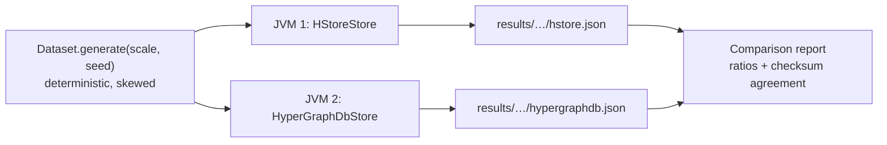

# Benchmarks: HStore and HyperGraphDB

This page compares HStore with [HyperGraphDB](https://github.com/hypergraphdb/hypergraphdb), the established
Java hypergraph database. Both run the same workloads on the same deterministic dataset in separate JVMs. Every
read workload is cross-checked: the two engines must return identical answers, as the "Results agree" column
shows. The harness lives in [`benchmarks/`](../benchmarks) and can be rerun on any machine.



## Setup

| | HStore | HyperGraphDB |
|---|---|---|
| Version | 0.1.0 (this repository) | 1.4 at commit `99485a1`, storage `bdb-je` on Berkeley DB JE 5.0.73 |
| Data model used | node type `Entity` (indexed by key, property `name`); `SET_EDGE` type `Relation` | `String` atoms; `HGPlainLink` links |
| Cache | node cache of half the heap, or `CACHE_MB` | JE cache at 30% of the heap (HyperGraphDB default), or `CACHE_MB`, plus the HyperGraphDB atom cache |
| `async` durability | `durability = async` | HyperGraphDB default: JE `WRITE_NO_SYNC` |
| `sync` durability | `durability = sync`, `wal_mode = references`, group commit | JE `COMMIT_SYNC`, and `Environment.flushLog(true)` after every commit (see below) |
| History | `history_limit = 64` generations retained for time travel (default) | none |

Each run used a 4 GiB heap and `-XX:+UseParallelGC` on Oracle GraalVM for JDK 25.0.4 (HotSpot JIT), on an Apple
M5 (4 performance and 6 efficiency cores) with 24 GiB of memory and an internal SSD, running macOS 26.5.1.

**Synchronous commits in HyperGraphDB.** HyperGraphDB 1.4 begins every JE transaction with an explicit
`WRITE_NO_SYNC` durability, which overrides the environment's `COMMIT_SYNC`. Setting the environment alone
leaves its commits unsynced: single-update commits took about 0.1 ms, while one forced write on the machine
above takes about 3.8 ms. In `sync` mode the adapter therefore calls `Environment.flushLog(true)` after every
commit, which writes and forces JE's log as `COMMIT_SYNC` would. Results for `sync` published before this
change measured HyperGraphDB without any sync.

**Dataset.** At scale *s*: 50,000·*s* nodes and 100,000·*s* hyperedges. Cardinality follows a geometric tail
starting at 2 (continue with probability 0.62, capped at 32), for a mean of 3.6. Members are drawn as
`⌊n · u^2.2⌋` for uniform `u`, so low-numbered nodes become hubs with large incidence sets, as in real
co-authorship, claims or citation data. Probe sets are 100,000 random nodes and hyperedges, 20,000 node pairs
taken from a common hyperedge (so co-membership counts are non-zero), and 20,000 updates. The seed is fixed
(`20260904`).

**Workloads.**

| Id | Operation | HStore API | HyperGraphDB API |
|---|---|---|---|
| `ingest.nodes` | insert nodes, 1,000 per transaction | `Writer.node` | `graph.add(String)` in `transact` |
| `ingest.edges` | insert hyperedges, 1,000 per transaction | `Writer.edge` + `Writer.load` | `graph.add(new HGPlainLink(…))` |
| `read.incidence` | enumerate a node's incidence set, 1,000 probes per read transaction | `Reader.forEachIncidentEdge` | `getIncidenceSet(h).getSearchResult()` |
| `read.members` | enumerate a hyperedge's members | `Reader.forEachMemberId` | `HGLink.getTargetAt` over `graph.get(h)` |
| `read.comembership` | count hyperedges containing both nodes of a pair | `TreeAlgebra.intersectKeys` (leapfrog) | `hg.count(hg.and(hg.incident(a), hg.incident(b)))` |
| `read.twohop` | count the distinct nodes that share a hyperedge with a node, 10,000 probes | `Reader.forEachIncidentEdge` + `Reader.forEachMemberId` | `getIncidenceSet` + the link's targets |
| `read.incidence.parallel` | `read.incidence` from one thread per core | same | same |
| `latency.read` | one incidence lookup per read transaction, each timed on its own | `Reader.forEachIncidentEdge` | `getIncidenceSet(h).getSearchResult()` |
| `write.update` | replace a node's value, 1,000 per transaction | `Writer.set` | `graph.replace` |
| `latency.commit` | 5,000 write transactions of one update each, each timed on its own | `Writer.set` | `graph.replace` |
| `mixed.read` | single incidence lookups from `threads − 1` threads for 10 s while `mixed.write` runs | `Reader.forEachIncidentEdge` | `getIncidenceSet(h).getSearchResult()` |
| `mixed.write` | one thread committing 10 updates at a time on a fixed schedule of 1,000 updates/s | `Writer.set` | `graph.replace` |
| `large.ingest` | one hyperedge containing every node | `Writer.load` | one `HGPlainLink` |
| `large.scan` | enumerate the large hyperedge 400 times, after the warm-up described below | `Reader.forEachMemberId` | `getTargetAt` loop |
| `large.probe` | test whether a node belongs to the large hyperedge | `View.incidence(edge, node)` (membership-tree lookup) | `getIncidenceSet(node).contains(edge)` |
| `reopen` | close and reopen, including recovery | `HypergraphDatabase.open` | `HGEnvironment.get` |
| `read.incidence.cold` | `read.incidence` immediately after reopening | | |
| `disk` | bytes on disk after a clean shutdown | | |
| `churn.delete` | delete 20% of the hyperedges, 1,000 per transaction | `Writer.delete` | `graph.remove` |
| `churn.remove` | remove one member from each of 20,000 other hyperedges, 1,000 per transaction | `Writer.remove` | `graph.replace` with a new `HGPlainLink` (links are immutable) |
| `read.incidence.churned` | `read.incidence` after the deletes | | |
| `disk.churned` | bytes on disk after the deletes and a clean shutdown | | |
| `compaction.baseline` | single-update commits at 50/s for 10 s, no compaction | `Writer.set` | `graph.replace` |
| `compaction` | the same commits while a full compaction runs, starting 1 s in | `StorageEngine.compact` | `Environment.cleanLog` until it finds nothing, then a forced checkpoint |
| `disk.compacted` | bytes on disk after the compaction and a clean shutdown | | |
| `recover` | open the store after the process ingesting into it was killed with SIGKILL | `HypergraphDatabase.open` | `HGEnvironment.get` |

Read workloads, `large.scan` and `latency.read` first repeat the whole workload for at least 2 seconds without
timing it. The exception is `read.incidence.cold`. Both engines get the same warm-up. The numbers describe a server that has been running for
a while, not one that has just started. With a warm-up over 10% of the probes, as earlier versions of this
benchmark did, most of the timed pass still ran before the JIT had compiled the read path. The timings mostly
showed how quickly each engine's code got compiled, and `read.members` came out about three times lower for
HStore than its steady rate.

The two `latency.*` workloads time every operation separately with `System.nanoTime()`. Each operation is a whole
transaction, as it would be for a request to a server. The report adds a second table with p50, p99, p99.9 and the
maximum, taking the median of each percentile across runs. Throughput hides occasional slow operations caused by
group commit, checkpoints, compaction or GC; these percentiles show them. Under `sync` durability,
`latency.commit` is effectively the cost of one durable commit.

**Reads during writes.** In `mixed`, the readers run in a closed loop for 10 s, and a single writer commits on a
fixed schedule (open loop). Each commit's latency is measured from when it was *scheduled* to start, not from
when it actually started. If the engine stalls, the commits queued behind the stall show the delay, instead of
the writer quietly slowing down. The writer stops at the deadline even when it is behind, so an engine that can't
keep up shows an achieved rate below 1,000 updates/s. Readers keep a uniform random sample of 200,000 latencies
each, plus the exact maximum. Both results depend on timing, so *Results agree* shows "n/a".

**Two hops.** `read.twohop` follows each probe node to its hyperedges and from there to their members. It runs
before `large.ingest`, because once the hyperedge containing every node exists, every node is two hops from all
the others. Each adapter uses plain incidence and member calls and its own id type: `long` ids, sorted and
de-duplicated, for HStore, and a `HashSet` of persistent handles for HyperGraphDB, which has no numeric ids.
HyperGraphDB's `HGBreadthFirstTraversal` isn't used, since it would measure that framework rather than the
storage underneath.

**Deletes.** The churn set is drawn from the same seed after everything else, so the rest of the dataset is
unchanged. It has 20% of the hyperedges to delete and 20,000 others, each with at least three members, that lose
one member. `disk` is recorded while the store is closed for a reopen, before the churn starts, so it still means
the loaded store after a clean shutdown. The checksum of `read.incidence.churned` has to agree, which confirms
both engines applied the same deletes. `disk.churned` shows whether the space came back: through compaction for
HStore, and the log cleaner for JE.

**Compaction.** After the churn, `disk.churned` is recorded at a reopen, and then two 10 s windows run. In both, one
writer commits a single update every 20 ms on a fixed schedule, and each commit's latency is measured from when it
was scheduled. In `compaction`, the store also runs a full compaction starting 1 s in, and the window lasts until
the compaction has finished. HStore calls `StorageEngine.compact()`. JE calls `cleanLog()` until it cleans nothing,
then forces a checkpoint so the cleaned files are deleted. The latency table compares the two windows, and the
*Resources* table adds the compaction time and the space reclaimed. Disk is measured at a reopen just before the
window and again at a reopen just after it, so segments that HStore only deletes once older readers are gone are
counted too. That figure can be negative when compaction frees less than the writer adds. The two windows run at a
fixed rate, so they are left out of the main table, where their ratio would always be about 1. HStore's default segments are 256 MiB, so
at scale 1 most data shares one or two segments. `--pages-per-segment` (`PAGES_PER_SEGMENT`) and
`--compaction-live-ratio` (`COMPACTION_LIVE_RATIO`) change HStore's settings for a run.

**Crash recovery.** `reopen` closes the store cleanly first. `recover` doesn't:
1. The run starts a second JVM (`Comparison crash`) with the same flags and classpath. It ingests nodes into a
   fresh directory and prints the count after every acknowledged commit.
2. Once half the nodes are acknowledged, the parent kills it with SIGKILL.
3. The parent times opening the directory, then counts the nodes that survived.

The *Resources* table shows how many acknowledged nodes were lost, including when it's zero. SIGKILL is a process
crash, not a power failure: bytes the engine handed to the operating system survive it even without an fsync. So
this measures recovery time and the engine's own buffering, not whether `sync` really reaches the disk. Torn
writes and lost fsyncs are covered by HStore's crash matrix (`CrashRecoveryTest`, see [development.md](development.md)), not by this
benchmark.

**Bytes written.** For every write workload the report also shows the bytes each engine wrote per operation, in a
*Resources* table, plus the total for the whole run. Both engines count the bytes they write themselves:

| HStore | HyperGraphDB |
|---|---|
| WAL bytes plus page bytes (`EngineStats.walBytes + dataBytesWritten`), including pages moved by compaction | sequential plus random write bytes from JE's `EnvironmentStats`, including the log cleaner |

Each write workload ends with a flush (an HStore checkpoint, `Environment.sync()` for JE) after its timed section,
so bytes still sitting in buffers are counted against the workload that produced them. The counters restart
when a store reopens, so the adapters carry the total across `reopen`. Bytes written during the final close
aren't counted.

**Amplification.** The *Resources* table also divides physical bytes by an estimate of the logical bytes involved:

| Ratio | Physical bytes | Logical bytes |
|---|---|---|
| write amplification | bytes written (above) | 8 bytes per id plus the value: `node-<i>` for a new node, 24 bytes for an updated value, `(cardinality + 1) × 8` for a new or deleted hyperedge, 16 bytes for a removed member |
| read amplification | bytes read from storage | 8 bytes per id the workload returned (its checksum counts them) |

HStore counts the bytes it reads from segment files (`EngineStats.dataBytesRead`): a first read of up to 4 KiB,
then the rest of the page image if it's bigger. JE reports sequential plus random read bytes. Reads served from a cache read nothing from storage, so read amplification mostly shows up for
cold reads and with a small `CACHE_MB`. The logical sizes are rough estimates; compare the two stores against each
other rather than reading the ratios as absolute numbers.

**Memory.** Every workload also records, from the JVM's own MXBeans, the bytes allocated
(`getTotalThreadAllocatedBytes` for the whole process; for the single-threaded read workloads, only the reading
thread's `getCurrentThreadAllocatedBytes`, so background maintenance doesn't count against a read) and the GC pause time (`GarbageCollectorMXBean.getCollectionTime`, which is
stop-the-world time with ParallelGC). Rows where both stores paused for 0 ms are left out. After ingest, the run
forces a full GC and records how much heap the loaded store keeps. A baseline taken before the store opens is
subtracted, so the shared dataset arrays don't count. This number mostly reflects how each engine's cache is
configured (see *Setup*).

## Results

These results come from HStore at commit `9291e18`, on the machine described in *Setup*, with both caches set to
64 MiB (`CACHE_MB=64`) and `THREADS=8`. Scale 1 ran 5 times per store in each durability mode, and scale 4 ran 3
times. Each cell is the median, with the slowest and fastest run in brackets. The machine was running other
work: sampled before each run, the one-minute load average was between 3.4 and 18.3 on 10 cores. Where the
bracketed ranges of the two stores overlap, treat the ratio as a tendency rather than a measured difference.

The [benchmark report](benchmark-report.pdf) has the full method, every table for all three configurations
(latency, bytes written, heap and GC), the value of every run, and the discussion. Its raw results, and the
script that builds its tables, are in [`benchmarks/report`](../benchmarks/report).

Ratios above 1 favour HStore. Throughput ratios divide HStore by HyperGraphDB; latency and size ratios divide
HyperGraphDB by HStore.

### Scale 1, `async` durability

Dataset: 50,000 nodes, 100,000 hyperedges, 362,757 incidences; durability async; 8 threads.

| Workload | HStore | HyperGraphDB | Ratio of medians | Results agree |
|---|---:|---:|---:|:---:|
| `ingest.nodes`: insert nodes in transactions of 1,000 | 67,741 ops/s (51,067 to 72,960) | 37,664 ops/s (32,804 to 40,002) | **1.80×** | yes |
| `ingest.edges`: insert hyperedges (mean cardinality 3.6) in transactions of 1,000 | 50,042 ops/s (42,339 to 54,792) | 34,971 ops/s (33,281 to 39,454) | **1.43×** | yes |
| `read.incidence`: enumerate the incidence set of a node | 6,263,882 ops/s (3,838,956 to 8,193,140) | 1,489,214 ops/s (1,399,430 to 1,585,233) | **4.21×** | yes |
| `read.members`: enumerate the members of a hyperedge | 6,114,743 ops/s (2,146,691 to 6,408,134) | 2,663,119 ops/s (1,620,982 to 3,486,067) | **2.30×** | yes |
| `read.comembership`: count hyperedges containing both atoms of a pair | 610,291 ops/s (560,312 to 788,357) | 53,899 ops/s (2,236 to 76,650) | **11.32×** | yes |
| `read.twohop`: count the distinct nodes that share a hyperedge with a node | 543,317 ops/s (335,820 to 574,014) | 98,274 ops/s (71,007 to 148,759) | **5.53×** | yes |
| `read.incidence.parallel`: incidence sets from 8 threads, 100,000 probes each | 36,557,085 ops/s (20,950,132 to 40,593,168) | 2,246,677 ops/s (1,947,200 to 2,675,350) | **16.27×** | yes |
| `latency.read`: one incidence lookup per read transaction | 3,833,633 ops/s (2,414,108 to 4,720,358) | 456,998 ops/s (372,257 to 558,321) | **8.39×** | yes |
| `write.update`: replace a node value in transactions of 1,000 | 69,879 ops/s (50,256 to 108,002) | 12,986 ops/s (10,565 to 19,117) | **5.38×** | yes |
| `latency.commit`: one node update per write transaction | 12,387 ops/s (10,410 to 14,893) | 14,088 ops/s (7,229 to 24,612) | **0.88×** | yes |
| `mixed.read`: single incidence lookups from 7 readers while one writer commits 10 updates at a time, targeting 1,000 updates/s | 2,457,466 ops/s (2,368,477 to 2,542,025) | 1,131,996 ops/s (1,059,891 to 1,199,589) | **2.17×** | n/a |
| `mixed.write`: updates committed by the writer alongside the readers | 1,000 ops/s (1,000 to 1,000) | 1,000 ops/s (999 to 1,000) | **1.00×** | n/a |
| `large.ingest`: create one hyperedge with 50,000 members | 610,120 ops/s (286,715 to 755,104) | 116,290 ops/s (83,926 to 136,066) | **5.25×** | yes |
| `large.scan`: enumerate all members of the large hyperedge (x400, after a warm-up) | 4,048,958,385 ops/s (3,507,028,260 to 4,912,948,690) | 1,122,938,397 ops/s (590,299,171 to 1,296,824,104) | **3.61×** | yes |
| `large.probe`: test whether a node belongs to the large hyperedge | 17,214,296 ops/s (9,625,064 to 19,639,451) | 1,824,713 ops/s (865,555 to 2,056,360) | **9.43×** | yes |
| `reopen`: close and reopen the database, including recovery | 111 ms (107 to 131) | 924 ms (674 to 1,361) | **8.29×** | yes |
| `read.incidence.cold`: incidence sets immediately after reopening | 4,044,844 ops/s (3,458,866 to 4,142,345) | 95,895 ops/s (89,040 to 136,966) | **42.18×** | yes |
| `disk`: bytes on disk after a clean shutdown | 92.4 MiB (90.4 to 92.6) | 346.4 MiB (289.6 to 371.8) | **3.75×** | yes |
| `churn.delete`: delete 20,000 hyperedges (20%) in transactions of 1,000 | 24,490 ops/s (20,169 to 29,917) | 7,904 ops/s (5,925 to 9,130) | **3.10×** | yes |
| `churn.remove`: remove one member from each of 20,000 other hyperedges, 1,000 per transaction | 43,155 ops/s (39,001 to 49,663) | 17,477 ops/s (16,078 to 19,754) | **2.47×** | yes |
| `read.incidence.churned`: enumerate incidence sets after the deletes | 8,398,538 ops/s (7,852,427 to 9,263,154) | 2,104,833 ops/s (932,051 to 2,516,987) | **3.99×** | yes |
| `disk.churned`: bytes on disk after the deletes and a clean shutdown | 117.1 MiB (114.1 to 117.9) | 219.8 MiB (203.2 to 302.1) | **1.88×** | yes |
| `disk.compacted`: bytes on disk after a full compaction and a clean shutdown | 91.2 MiB (91.2 to 91.2) | 198.1 MiB (188.1 to 265.7) | **2.17×** | yes |
| `recover`: open the store after killing the ingest process with SIGKILL | 128 ms (106 to 153) | 76 ms (61 to 88) | **0.59×** | n/a |

Latency of single operations, median of each percentile across runs:

| Workload | Percentile | HStore | HyperGraphDB | Ratio |
|---|---|---:|---:|---:|
| `latency.read` | p50 | 0.2 µs | 0.9 µs | **4.39×** |
| `latency.read` | p99 | 0.5 µs | 12.7 µs | **25.33×** |
| `latency.read` | p99.9 | 1.5 µs | 22.6 µs | **15.06×** |
| `latency.read` | max | 44.0 µs | 1.06 ms | **24.16×** |
| `latency.commit` | p50 | 52.0 µs | 45.5 µs | **0.87×** |
| `latency.commit` | p99 | 295.7 µs | 465.5 µs | **1.57×** |
| `latency.commit` | p99.9 | 441.0 µs | 936.1 µs | **2.12×** |
| `latency.commit` | max | 1.85 ms | 7.36 ms | **3.98×** |
| `mixed.read` | p50 | 1.8 µs | 3.3 µs | **1.86×** |
| `mixed.read` | p99 | 10.5 µs | 54.5 µs | **5.21×** |
| `mixed.read` | p99.9 | 25.7 µs | 305.5 µs | **11.90×** |
| `mixed.read` | max | 28.51 ms | 28.50 ms | **1.00×** |
| `mixed.write` | p50 | 2.33 ms | 2.90 ms | **1.25×** |
| `mixed.write` | p99 | 9.65 ms | 16.94 ms | **1.75×** |
| `mixed.write` | p99.9 | 22.02 ms | 34.41 ms | **1.56×** |
| `mixed.write` | max | 22.02 ms | 34.41 ms | **1.56×** |
| `compaction.baseline` | p50 | 3.31 ms | 3.36 ms | **1.02×** |
| `compaction.baseline` | p99 | 5.43 ms | 7.50 ms | **1.38×** |
| `compaction.baseline` | p99.9 | 8.80 ms | 10.52 ms | **1.20×** |
| `compaction.baseline` | max | 8.80 ms | 10.52 ms | **1.20×** |
| `compaction` | p50 | 3.36 ms | 3.24 ms | **0.97×** |
| `compaction` | p99 | 5.44 ms | 11.59 ms | **2.13×** |
| `compaction` | p99.9 | 6.17 ms | 84.26 ms | **13.66×** |
| `compaction` | max | 6.17 ms | 84.26 ms | **13.66×** |

### Scale 1, `sync` durability

Dataset: 50,000 nodes, 100,000 hyperedges, 362,757 incidences; durability sync; 8 threads.

| Workload | HStore | HyperGraphDB | Ratio of medians | Results agree |
|---|---:|---:|---:|:---:|
| `ingest.nodes`: insert nodes in transactions of 1,000 | 55,831 ops/s (25,612 to 60,845) | 30,898 ops/s (25,247 to 33,003) | **1.81×** | yes |
| `ingest.edges`: insert hyperedges (mean cardinality 3.6) in transactions of 1,000 | 37,061 ops/s (16,880 to 43,465) | 29,575 ops/s (13,674 to 32,075) | **1.25×** | yes |
| `read.incidence`: enumerate the incidence set of a node | 6,914,354 ops/s (2,181,969 to 8,485,453) | 997,154 ops/s (455,024 to 1,403,695) | **6.93×** | yes |
| `read.members`: enumerate the members of a hyperedge | 5,423,092 ops/s (2,346,275 to 6,910,830) | 2,378,494 ops/s (1,139,475 to 3,352,302) | **2.28×** | yes |
| `read.comembership`: count hyperedges containing both atoms of a pair | 623,412 ops/s (225,960 to 750,270) | 40,468 ops/s (28,205 to 76,472) | **15.41×** | yes |
| `read.twohop`: count the distinct nodes that share a hyperedge with a node | 349,091 ops/s (212,259 to 575,284) | 104,597 ops/s (68,930 to 118,502) | **3.34×** | yes |
| `read.incidence.parallel`: incidence sets from 8 threads, 100,000 probes each | 26,820,024 ops/s (8,343,759 to 41,000,847) | 1,959,562 ops/s (1,354,823 to 2,040,085) | **13.69×** | yes |
| `latency.read`: one incidence lookup per read transaction | 3,592,293 ops/s (1,615,246 to 4,602,083) | 437,799 ops/s (274,315 to 695,056) | **8.21×** | yes |
| `write.update`: replace a node value in transactions of 1,000 | 64,088 ops/s (42,466 to 77,527) | 8,736 ops/s (3,640 to 10,551) | **7.34×** | yes |
| `latency.commit`: one node update per write transaction | 258 ops/s (244 to 260) | 236 ops/s (229 to 237) | **1.09×** | yes |
| `mixed.read`: single incidence lookups from 7 readers while one writer commits 10 updates at a time, targeting 1,000 updates/s | 2,283,312 ops/s (1,936,304 to 2,346,786) | 1,048,371 ops/s (885,124 to 1,088,745) | **2.18×** | n/a |
| `mixed.write`: updates committed by the writer alongside the readers | 1,000 ops/s (1,000 to 1,000) | 1,000 ops/s (1,000 to 1,000) | **1.00×** | n/a |
| `large.ingest`: create one hyperedge with 50,000 members | 611,622 ops/s (330,705 to 701,290) | 68,501 ops/s (44,204 to 124,867) | **8.93×** | yes |
| `large.scan`: enumerate all members of the large hyperedge (x400, after a warm-up) | 3,856,784,479 ops/s (1,065,939,440 to 4,213,853,042) | 921,639,492 ops/s (673,177,777 to 1,080,788,976) | **4.18×** | yes |
| `large.probe`: test whether a node belongs to the large hyperedge | 11,861,283 ops/s (8,958,098 to 17,241,257) | 1,229,677 ops/s (819,877 to 1,814,296) | **9.65×** | yes |
| `reopen`: close and reopen the database, including recovery | 128 ms (119 to 148) | 1,077 ms (858 to 1,245) | **8.44×** | yes |
| `read.incidence.cold`: incidence sets immediately after reopening | 2,929,216 ops/s (2,168,586 to 4,181,768) | 104,708 ops/s (94,852 to 142,580) | **27.98×** | yes |
| `disk`: bytes on disk after a clean shutdown | 93.3 MiB (91.8 to 93.7) | 321.7 MiB (305.6 to 350.8) | **3.45×** | yes |
| `churn.delete`: delete 20,000 hyperedges (20%) in transactions of 1,000 | 26,928 ops/s (10,040 to 28,095) | 5,485 ops/s (4,237 to 8,294) | **4.91×** | yes |
| `churn.remove`: remove one member from each of 20,000 other hyperedges, 1,000 per transaction | 36,834 ops/s (21,182 to 40,925) | 11,888 ops/s (9,157 to 14,220) | **3.10×** | yes |
| `read.incidence.churned`: enumerate incidence sets after the deletes | 8,441,520 ops/s (6,577,667 to 9,027,409) | 1,129,728 ops/s (982,393 to 1,799,620) | **7.47×** | yes |
| `disk.churned`: bytes on disk after the deletes and a clean shutdown | 118.5 MiB (117.1 to 127.5) | 256.5 MiB (195.4 to 276.1) | **2.17×** | yes |
| `disk.compacted`: bytes on disk after a full compaction and a clean shutdown | 91.2 MiB (91.2 to 91.2) | 190.4 MiB (182.5 to 277.1) | **2.09×** | yes |
| `recover`: open the store after killing the ingest process with SIGKILL | 113 ms (107 to 184) | 78 ms (54 to 78) | **0.69×** | n/a |

### Scale 4, `async` durability

Dataset: 200,000 nodes, 400,000 hyperedges, 1,453,427 incidences; durability async; 8 threads.

| Workload | HStore | HyperGraphDB | Ratio of medians | Results agree |
|---|---:|---:|---:|:---:|
| `ingest.nodes`: insert nodes in transactions of 1,000 | 40,009 ops/s (33,982 to 57,601) | 28,712 ops/s (26,707 to 38,938) | **1.39×** | yes |
| `ingest.edges`: insert hyperedges (mean cardinality 3.6) in transactions of 1,000 | 21,132 ops/s (19,987 to 27,311) | 2,050 ops/s (1,725 to 2,736) | **10.31×** | yes |
| `read.incidence`: enumerate the incidence set of a node | 6,567,839 ops/s (6,370,914 to 7,065,286) | 574,929 ops/s (549,276 to 1,290,467) | **11.42×** | yes |
| `read.members`: enumerate the members of a hyperedge | 5,575,872 ops/s (4,558,084 to 5,931,873) | 1,731,668 ops/s (1,449,441 to 1,834,122) | **3.22×** | yes |
| `read.comembership`: count hyperedges containing both atoms of a pair | 357,920 ops/s (306,442 to 380,508) | 18,128 ops/s (17,264 to 53,840) | **19.74×** | yes |
| `read.twohop`: count the distinct nodes that share a hyperedge with a node | 311,293 ops/s (226,920 to 397,015) | 71,578 ops/s (46,798 to 96,728) | **4.35×** | yes |
| `read.incidence.parallel`: incidence sets from 8 threads, 100,000 probes each | 14,848,396 ops/s (9,710,034 to 17,930,486) | 1,459,037 ops/s (1,355,328 to 1,835,461) | **10.18×** | yes |
| `latency.read`: one incidence lookup per read transaction | 2,358,391 ops/s (1,510,230 to 2,532,733) | 350,668 ops/s (205,075 to 361,613) | **6.73×** | yes |
| `write.update`: replace a node value in transactions of 1,000 | 51,937 ops/s (21,950 to 67,587) | 1,569 ops/s (1,434 to 2,282) | **33.10×** | yes |
| `latency.commit`: one node update per write transaction | 12,193 ops/s (8,383 to 16,763) | 2,261 ops/s (1,783 to 2,547) | **5.39×** | yes |
| `mixed.read`: single incidence lookups from 7 readers while one writer commits 10 updates at a time, targeting 1,000 updates/s | 1,984,771 ops/s (1,929,424 to 2,177,523) | 855,896 ops/s (840,015 to 1,007,499) | **2.32×** | n/a |
| `mixed.write`: updates committed by the writer alongside the readers | 1,000 ops/s (1,000 to 1,000) | 1,000 ops/s (994 to 1,000) | **1.00×** | n/a |
| `large.ingest`: create one hyperedge with 200,000 members | 489,256 ops/s (357,717 to 530,352) | 12,076 ops/s (11,960 to 12,329) | **40.51×** | yes |
| `large.scan`: enumerate all members of the large hyperedge (x400, after a warm-up) | 3,638,203,410 ops/s (2,471,360,485 to 3,728,075,827) | 431,469,984 ops/s (151,006,446 to 452,912,545) | **8.43×** | yes |
| `large.probe`: test whether a node belongs to the large hyperedge | 11,711,888 ops/s (6,814,155 to 15,438,751) | 707,036 ops/s (363,080 to 1,115,133) | **16.56×** | yes |
| `reopen`: close and reopen the database, including recovery | 206 ms (130 to 242) | 1,157 ms (1,028 to 1,270) | **5.61×** | yes |
| `read.incidence.cold`: incidence sets immediately after reopening | 1,163,030 ops/s (984,567 to 2,006,144) | 13,081 ops/s (12,526 to 13,314) | **88.91×** | yes |
| `disk`: bytes on disk after a clean shutdown | 165.7 MiB (164.9 to 166.4) | 2294.8 MiB (2211.7 to 2367.2) | **13.85×** | yes |
| `churn.delete`: delete 80,000 hyperedges (20%) in transactions of 1,000 | 3,388 ops/s (2,225 to 4,295) | 1,426 ops/s (1,308 to 1,459) | **2.38×** | yes |
| `churn.remove`: remove one member from each of 20,000 other hyperedges, 1,000 per transaction | 5,771 ops/s (3,508 to 6,005) | 1,919 ops/s (1,677 to 2,722) | **3.01×** | yes |
| `read.incidence.churned`: enumerate incidence sets after the deletes | 5,677,396 ops/s (3,467,056 to 6,307,954) | 1,015,417 ops/s (531,391 to 1,302,526) | **5.59×** | yes |
| `disk.churned`: bytes on disk after the deletes and a clean shutdown | 1238.9 MiB (1225.2 to 1239.6) | 1879.4 MiB (1846.6 to 1966.1) | **1.52×** | yes |
| `disk.compacted`: bytes on disk after a full compaction and a clean shutdown | 164.5 MiB (164.5 to 164.5) | 1159.1 MiB (1119.0 to 1176.9) | **7.05×** | yes |
| `recover`: open the store after killing the ingest process with SIGKILL | 219 ms (189 to 257) | 455 ms (327 to 527) | **2.08×** | n/a |

## Analysis

**Where HStore leads, and why.**

* **Incidence enumeration (4.2–11×), co-membership (11–20×) and cold reads after a reopen (28–89×).** An
  atom's incidence set is one entry of the reverse index: a short list stored inline for most atoms, and a
  counted B+tree for hubs. Enumeration hands each hyperedge id to the caller without allocating, and
  co-membership is a leapfrog intersection that skips whole subtrees by their summaries
  ([persistent-tree.md](storage/persistent-tree.md)). HyperGraphDB opens a JE cursor on a duplicate set for
  each lookup, and its `hg.and` query plans a general join.
* **Updates (5.4–33×) and bytes written.** A commit logs only the keys it changed, a few hundred bytes, and a
  checkpoint writes each changed node once for all the commits since the previous one
  ([wal-and-recovery.md](transactions/wal-and-recovery.md)). A JE commit appends a new version of every changed
  record and of the B+tree nodes above it. With `async` durability, a single-update commit writes 659 B in
  HStore against 6.9 KiB in HyperGraphDB.
* **Member enumeration at scale 4 (3.2×) and two-hop queries (3.3–5.5×).** A catalog leaf in the node cache
  keeps its page bytes and decodes a record only when it is read
  ([persistent-tree.md](storage/persistent-tree.md)), so the catalog stays within a 64 MiB cache: at scale 4
  a member lookup read nothing from the segment files and allocated nothing. At scale 1 HStore is also ahead
  (2.3×), with overlapping ranges.
* **Giant hyperedges (ingest 5.3–41×, probes 9.4–17×).** Large edges are bulk-built bottom-up, and a membership
  probe is one descent of the edge's membership tree.
* **Disk (3.5–14× smaller after load).** Ids are 8-byte varint gaps instead of 16-byte handles, node images are
  packed into 64-byte units, small member trees and incidence sets live inside their parent record, and the WAL
  is truncated at every checkpoint.
* **Tail latency.** HStore's p99 and p99.9 are lower in every latency workload, by 1.1–35×. Readers pin an
  immutable generation and never wait for writers, checkpoints or compaction.

**Where HyperGraphDB leads, and why.**

* **Opening a crashed store at scale 1 (0.59× with `async`, 0.69× with `sync`).** HyperGraphDB opened the
  crashed store in 76 ms against HStore's 128 ms, and the ranges don't overlap. HStore's time is close to its
  clean reopen of the full dataset (111 ms), and it allocates 121 MiB while opening, against 78 MiB for
  HyperGraphDB. At scale 4 the order reverses: 219 ms for HStore against 455 ms.

**Where the two are close.**

* **Single-update commits at scale 1.** With `async` durability HyperGraphDB is slightly ahead at the median
  (0.88×, 52 µs against 45 µs, ranges overlapping), and HStore is ahead at p99 and above. With `sync`
  durability (1.09×) both stores pay about 4 ms for the forced write of each commit on this machine, and
  HStore's p99.9 is 1.5× lower. JE reports 497 KiB written per commit in `sync` mode, against 6.9 KiB with
  `async`; the extra bytes come with the log flush the adapter adds (see *Setup*), and we haven't established
  what JE writes, so don't read the `sync` bytes-written figures for single commits as a comparison.
* **Bulk node and hyperedge ingest at scale 1 with `sync` (1.81× and 1.25×), and node ingest at scale 4
  (1.39×).** The ranges overlap in all three.
* **Crash safety.** Neither store lost an acknowledged commit in any run.

**What HStore spends.** It retains more heap after ingest (190 MiB against 118 MiB at scale 1, 430 MiB against
299 MiB at scale 4), because the retained heap includes up to `write_buffer_mb` of nodes no checkpoint has
written yet. After a large delete, its files grow until the retained history stops referencing the replaced
pages: at scale 4 they reached 1.21 GiB before compaction brought them back to 164.5 MiB. At scale 4 its
single-update commits are faster at every percentile, but the slowest single commit across all runs was
HStore's: 30.5 ms against 18.8 ms.

### Decoding leaf records on demand

Storage format 8 writes each record of a catalog or incidence index leaf with its length in front, and a leaf
loaded from a page keeps the page bytes and decodes a record the first time it is read
([pages.md](storage/pages.md), [persistent-tree.md](storage/persistent-tree.md)). Before, a cache miss decoded
every record of the leaf, about 80 of them with their inline member lists, to return one. A fully decoded
catalog leaf took about 11 times the heap of its page image, and at scale 4 only about half the catalog fit in
the 64 MiB node cache.

The table compares HStore at scale 4 (`async`, `CACHE_MB=64`, three runs each) at commit `459b8be`, which
decoded whole leaves, and at commit `9291e18`. The two sets of runs were made at different times with
different machine load, so treat the throughput columns as indicative. Allocation and bytes read per
operation are steady from run to run.

| Workload | Before | After | Allocated per op | Read from storage per op |
|---|---:|---:|---:|---:|
| `read.members` | 218,369 ops/s | 5,575,872 ops/s | 9,038 B → 0 B | 778 B → 0 B |
| `read.twohop` | 15,008 ops/s | 311,293 ops/s | 133,848 B → 1,183 B | 12,464 B → 278 B |
| `read.incidence.cold` | 346,015 ops/s | 1,163,030 ops/s | 1,024 B → 595 B | 110 B → 113 B |

The length in front of each record costs about one byte, so the files grow slightly: 165.1 MiB against
165.7 MiB at scale 4, and 91.3 MiB against 92.2 MiB at scale 1. At scale 1, three alternated runs of each
build moved no workload by more than the spread between runs, apart from incidence reads from 8 threads,
which were 1.28× faster.

### Inline member trees

Storage format 6 started keeping a hyperedge's member tree inside its catalog record when it is a single leaf
of at most 32 members that fits in about 100 bytes ([persistent-tree.md](storage/persistent-tree.md#inline-trees)), and member
leaves without per-member columns no longer hold an `Incidence` object per member. The table compares HStore
before and after those two changes, alone, at scale 1 with `async` durability and `CACHE_MB=64`: three runs of
each build, alternated, median shown. The machine was busy with other work during these runs, so the
throughput column moves around by a lot from run to run. Allocation, bytes read and disk are steady and are the
numbers to trust.

| Workload | Before | After | Allocated per op | Read from storage per op |
|---|---:|---:|---:|---:|
| `read.members` | 615,661 ops/s | 726,507 ops/s | 979 B → 493 B | 73 B → 0 B |
| `read.twohop` | 63,817 ops/s | 90,044 ops/s | 8,760 B → 5,947 B | 337 B → 0 B |
| `large.scan` | 799 M ops/s | 687 M ops/s | 0 B → 0 B | 0 B → 0 B |
| `large.probe` | 2.00 M ops/s | 1.72 M ops/s | 168 B → 232 B | 0 B → 2 B |
| `ingest.edges` | 16,115 ops/s | 15,941 ops/s | 58.1 KB → 34.9 KB | |
| `churn.remove` | 8,589 ops/s | 12,425 ops/s | 61.0 KB → 47.4 KB | |

| Size | Before | After |
|---|---:|---:|
| `disk` after load | 197.2 MiB | 145.4 MiB |
| `disk.churned` | 430.3 MiB | 296.5 MiB |
| `disk.compacted` | 201.6 MiB | 66.1 MiB |
| bytes written by `ingest.edges` | 152.5 MiB | 127.8 MiB |
| heap retained after ingest | 53.7 MiB | 39.1 MiB |

Member reads no longer touch a page of their own, which removes the reads that missed the 64 MiB cache. The one
cost is in `large.probe`, which looks up a single member of the 50,000 member edge: its `Incidence` is now built
when it is read instead of being kept in the cached leaf, about 64 bytes per lookup.

## Reproducing

```
benchmarks/install-hypergraphdb.sh                 # clone, compile and install HyperGraphDB 99485a1 and JE 5.0.73
SCALE=1 DURABILITY=async CACHE_MB=64 THREADS=8 RUNS=5 benchmarks/run.sh
SCALE=1 DURABILITY=sync  CACHE_MB=64 THREADS=8 RUNS=5 benchmarks/run.sh
SCALE=4 DURABILITY=async CACHE_MB=64 THREADS=8 RUNS=3 benchmarks/run.sh
```

`run.sh` builds the `benchmarks` module (`-Pbenchmarks`) and runs each store in its own JVM, `RUNS` times
(default 3), alternating the two stores so slow periods hit both. It writes
`benchmarks/results/scale-<s>-<durability>-history-<h>/{hstore,hypergraphdb}-<run>.json`, plus a Markdown report
`report.md` in the same directory. Each cell in the report is the median over the runs, with the fastest and slowest
run in brackets, and "Results agree" requires every run of both stores to return the same checksum. `THREADS`
and `HEAP` override the thread count and heap size. Close other
workloads first: the numbers are only meaningful on an otherwise idle machine.

**Equal cache budgets.** By default the two caches are not the same size. HStore's node cache gets half the heap
(2 GiB with the default `HEAP=4g`). HyperGraphDB gets JE's default of 30% of the
heap. `CACHE_MB` gives both the same budget:

| HStore | HyperGraphDB |
|---|---|
| node cache of `CACHE_MB`, each node counted at an estimate of its heap size | JE cache of exactly `CACHE_MB` |

HStore's estimate runs 10 to 40% below the heap a node really takes, and HyperGraphDB's own atom and incidence
caches can't be capped in bytes (they shrink under memory pressure). So check the retained-heap line in the report to see what
each store actually kept. Results go to a directory ending in `-cache-<mb>`.

```
SCALE=4 CACHE_MB=64 benchmarks/run.sh   # working set several times larger than either cache
```

With a small budget, reads that miss the cache go to the files, but the operating system's page cache will
usually still serve them from memory. Reads only really hit the disk when the data is larger than the machine's
free RAM.
