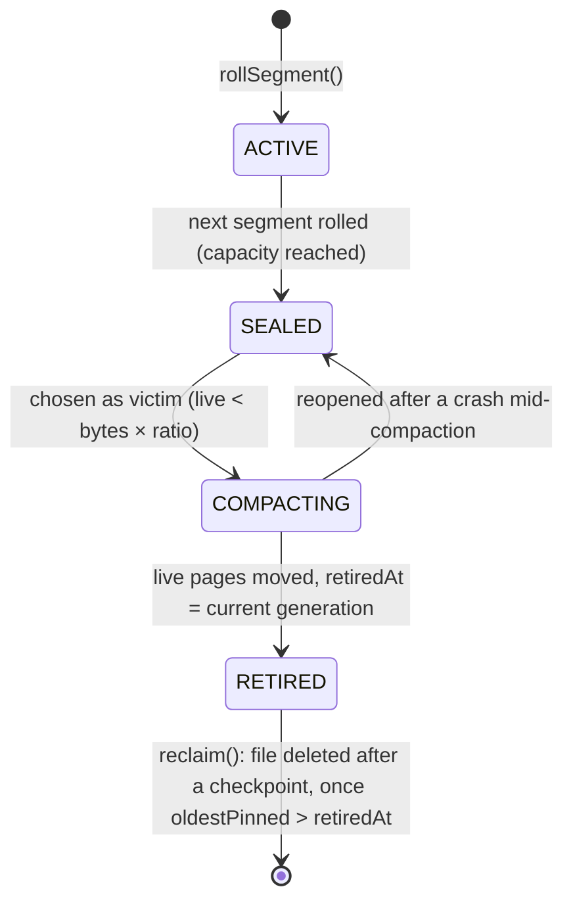

# Maintenance: checkpoints, compaction and verification

Copy-on-write storage never overwrites data, so three background concerns replace in-place update:

* **Checkpoints** bound recovery time and WAL size.
* **Reference counting and compaction** find the node images nothing can reach any more and return their space to
  the file system.
* **Verification** proves that what is on disk is internally consistent.

Sources are under `engine/src/main/java/io/hstore/engine/maintenance/`, plus `StorageEngine.java`, `page/PageStore.java`, `page/ReferenceCounts.java`, `tree/TreeWalker.java` and `tree/TreeVerifier.java`.

## Who runs what

| Trigger | Action | Code |
|---|---|---|
| Engine open, after recovery | checkpoint, then reclaim | `StorageEngine` constructor |
| `hstore-maintenance` virtual thread, every 500 ms (skipped when the `maintenance` lock is busy) | checkpoint if more than `checkpointWalBytes` of WAL or of pages were written since the last one, or more than 1 048 576 counts changed; compact one segment if any is below `compaction_live_ratio` (followed by a checkpoint); then reclaim | `StorageEngine.maintain` |
| `CHECKPOINT;` (HQL), `StorageEngine.checkpoint()` | checkpoint | `timedCheckpoint` |
| `COMPACT;` (HQL), `StorageEngine.compact()` | checkpoint, compact, checkpoint, reclaim | `StorageEngine.compact` |
| `hstore-references` platform thread, after every published commit | update reference counts | `ReferenceCounter` |
| `StorageEngine.close()` | final checkpoint, then shutdown | `close` |

Checkpoint and compaction are serialized by `StorageEngine.maintenance`, a `ReentrantLock`. Background compaction plays the role of PostgreSQL's autovacuum. It runs whenever a sealed segment's live bytes fall below `compaction_live_ratio` of its allocated bytes, which the reference counts keep up to date, and it empties one segment per pass, the emptiest. `COMPACT;` empties every such segment on demand.

Every checkpoint is logged, and then the checkpoint listeners run. The database registers `SemanticPlane.persist`, which saves the HNSW index alongside the catalog. A sample log line:

```text
2026-10-04 06:25:10.429 IST [23683] LOG:  [engine] checkpoint complete: generation 198, lsn 203,200, 1 wal segments retained, 25 ms
```

## Checkpoints

`Checkpointer.checkpoint()` (`maintenance/Checkpointer.java`) first syncs the segment files and forces the page directory without holding anything, so that most of the data written since the last checkpoint is on disk before commits have to wait. The rest runs inside `TransactionManager.exclusive(...)`. That holds the commit lock **and drains the group committer**, so every appended commit is also published and nothing is in flight. It then lets the reference counter catch up with every published commit and pauses it (`ReferenceCounter.pause`). Then:

1. It reads `lsn = wal.end()`.
2. It releases the pages that died before the oldest generation anyone can still read (see [Releasing pages](#releasing-pages)).
3. `pages.checkpoint()` fsyncs every dirty segment file and forces the page directory.
4. `pages.journal(lsn)` writes every count changed since the last checkpoint, and every directory entry released, to `pages.ref.journal`, and fsyncs it.
5. `feed.sync()` fsyncs the active feed segment.
6. It captures `current` and the retained history: all retained generations except current, newest first, at most `historyLimit`.
7. `catalog.publish(new CatalogImage(current, history, pages.segments(), lsn, feed.size()))` writes the image durably and atomically ([catalog-and-generations.md](catalog-and-generations.md#catalog-images-checkpoints)). The image includes every segment's `(id, state, pages, units, retiredAt)`.
8. It appends a `WalRecord.Checkpoint(0, generation, lsn)` and calls `wal.sync()`.
9. `wal.truncateBefore(lsn)` deletes WAL segment files that end before the checkpoint LSN. They are no longer needed, because the catalog image now covers them.
10. The commit lock is released here, and commits carry on. `pages.applyJournal()` writes the journaled counts into `pages.ref` and clears the released directory entries, forces both files, and empties the journal. The counter stays paused until this is done, so the counts it writes next start from the applied state.
11. It remembers `lastLsn = lsn` and resumes the counter.

**Trigger threshold.** `walSinceCheckpoint() = wal.end() − lastLsn` is compared with `checkpoint_wal_mb` (default 256 MiB, `EngineOptions.checkpointWalBytes`). In the default `PAGE_REFERENCES` WAL mode a commit logs about 47 bytes per new node image instead of the image itself. The threshold therefore corresponds to far more committed work than in `PAGE_IMAGES` mode, and replay after a crash stays short.

**What recovery gains.** Recovery loads the newest valid catalog image and replays only WAL records after `checkpointLsn` ([wal-and-recovery.md](../transactions/wal-and-recovery.md)). The image's persisted history makes time travel survive restarts. Its segment table restores the allocator position (`units`) and the compaction state machine.

## Space reclamation

### Why space needs reclaiming

Each commit writes fresh node images for every path it changes and references all unchanged subtrees from the previous generation ([persistent-tree.md](persistent-tree.md#update-algorithm)). The images a commit replaced stay on disk. They are still *reachable* while a retained generation references them, which is what makes time travel possible. Once the generations that reference them leave history, they are garbage.

Segments are append-only extents ([pages.md](pages.md#segment-files)), so garbage is never reused piecemeal. It is reclaimed one whole segment at a time:

1. count, for every page, how many pages and branch roots point at it, and note when that number reaches zero;
2. once no reader can reach such a page any more, release it and take its bytes off its segment's live total;
3. copy the remaining pages out of mostly-dead segments, byte for byte, and point their entries in the page
   directory at the copies;
4. delete the files once a checkpoint has made the new entries durable and no reader can still be using an old
   address.

No tree is rewritten and no generation is committed. Pages keep their numbers when they move
([pages.md](pages.md#page-numbers-and-the-page-directory)), so every node that points at a moved page, in every
generation and branch, still points at it.

### Segment state machine



`SegmentState.canTransitionTo` allows only the next state, plus `COMPACTING → SEALED`. `SegmentInfo.withState` throws on anything else. `PageStore.open` turns a `COMPACTING` segment back into `SEALED`, so a compaction cut short by a crash leaves the segment a candidate for the next pass. Only one segment is `ACTIVE` at a time: the one `PageStore.allocate` appends to. It is never chosen as a victim.

### Reference counts

Every page number has a count in `data/segments/pages.ref` ([pages.md](pages.md#reference-counts)): the number of
places that point at it in the current state of the database. A place is a branch's root for a slot, a child
reference in a branch node, or a nested tree's root inside a leaf value, such as an edge's member tree in the
catalog. A page that two branches share through one parent is counted once for that parent, not once per branch.

**After each commit.** When the group committer publishes a generation, it hands `ReferenceCounter` the generation
before and the one after. The counter works on its own thread (`hstore-references`), in commit order, so the commit
itself only pays for putting that pair on a queue. For each branch whose roots changed it compares the two root
vectors and then:

1. Adds one to every new root. A page whose count goes up from zero is new, or was written by a bulk load, so the
   pages it points at get one more as well, and so on down.
2. Takes one from every old root. A page whose count reaches zero is dead, so the pages it pointed at lose one too.

Step 1 runs to the end before step 2 starts, and its additions are collected in a small map first. When a commit
replaces a node, the new copy adds one to each child and the old one takes it away again, so those children cancel
out and their counts are never touched. What the counter really writes is the few pages that a commit added or
removed. Reading a node's references needs the node, which almost always comes from the node cache since the commit
just wrote it or read it. A leaf below a branch node is never read when its tree's values hold no references,
since the branch already says its children are leaves. Other leaves are read only as far as the header when they
aren't cached: a header flag (`PageHeader.REFERS_TO_PAGES`) says whether any value in the leaf points at another
page, and most leaves, such as catalog leaves holding nodes and index leaves with inline postings, don't. That keeps
counting the commits replayed after a crash about as cheap as replaying them.

A page that dies is marked with the generation it died in. Older generations can still reach it, so its bytes stay
where they are until no one can read those generations (see below).

**Pages nothing commits.** `Transaction.load` can write pages before the transaction commits. If the transaction
aborts, fails with a conflict, or turns out to repeat a request that already committed, those pages are marked dead
straight away. If it commits but replaced some of them
before committing, the ones the new trees don't reach are marked dead after the commit is counted. Pages written by
a transaction that a crash cut short are found on the next open (see below).

**Between checkpoints** the changes live in a map in memory (`ReferenceCounts.changed`) and `pages.ref` itself is
not touched. A checkpoint journals them and then applies them (steps 4 and 10 above), so a crash at any point leaves
the file as of one checkpoint or the next, never a mix. The background thread checkpoints early when more than
1 048 576 counts have changed, which keeps that map to a few tens of megabytes. It also checkpoints after every
`checkpoint_wal_mb` of pages written, because a bulk load writes many pages for little WAL and its dead pages would
otherwise wait a long time to be released.

**On open**, `PageStore.open` applies `pages.ref.journal` if it was written by the checkpoint the catalog points at
and ignores it otherwise. `ReferenceCounter.recover` then counts the generations recovery replayed from the WAL, in
order, exactly as it would have after each commit. Last, one pass over `pages.dir` and `pages.ref`:

* releases every page that has an address but a count of zero and isn't marked dead. No committed generation
  points at it; it was written by a transaction that never committed;
* adds up the live bytes of each segment;
* collects the dead pages that are still waiting, in order of the generation they died in.

**If counting fails**, for example on a page that can't be read, the counter stops, logs an error and marks
`pages.ref` for rebuilding. It releases nothing more until the engine restarts, so the worst case is space that
isn't reclaimed. The next open sees the mark and recounts from the retained generations: every page reachable from
the current state gets its exact count, and every page only older generations reach is marked dead as of the current
generation. That walk reads every node of every retained tree, so it takes as long as `hstore check`.

### Releasing pages

A page that died in generation `g` can only be reached from generations older than `g`. The checkpoint computes the
oldest generation anyone can still read, `TransactionManager.oldestReadable()`: the oldest retained generation or the
oldest pinned one, whichever is smaller. Every waiting page that died at or before that generation is released: its
count goes to zero, its directory entry is cleared, and its bytes come off the live total of the segment it sits in.
Those live totals are what compaction chooses victims by.

Readers pin their generation and then check that it is still retained, and `trimHistory` puts a generation back if
it finds a pin on it after removing it. Between the two, a reader can't end up holding a generation whose pages were
released.

Releases only happen inside a checkpoint, and the checkpoint journals the cleared directory entries with the counts.
A release therefore never reaches the disk before the catalog that justifies it, and a crash can't bring back an old
generation whose pages are gone.

`StorageEngine.liveness()` returns the live bytes of each segment, and the Studio dashboard shows them next to
`SegmentInfo.pages` and `bytes()`. Dead pages that are still waiting count as live, since they still have to be
moved if their segment is compacted.

### Compaction

`Compactor.compact(liveThreshold)` (default threshold `compaction_live_ratio = 0.5`):

1. **Choose victims.** A victim is a `SEALED` segment, not the active one, with `live bytes < allocated bytes ×
   threshold`, so the ratio is *live bytes / bytes written*. Every page allocated in it must also have been written
   (`PageStore.settled`); a commit allocates its pages before it logs them and writes them right after, so a
   segment can be sealed while a few of its pages are still on their way. Candidates are ordered from emptiest to
   fullest. The background pass takes only the first one (`compact(threshold, 1)`); `COMPACT` takes all of them.
2. Mark the victims `COMPACTING`.
3. **Move.** `PageStore.evacuate` reads through the victim one 64-byte unit at a time. Where a page header starts and
   the directory entry for that header's page number points at exactly this spot, the page is live: it is checked
   with `PageHeader.verify` and its bytes are written to the active segment. Anything else, such as a released page
   or the old copy of a page that has already moved, is skipped. The header holds the page number, not
   the address, so neither the header nor the checksum changes. Every 4 MiB of copies, the segments are synced and
   only then are the directory entries pointed at the copies, so an entry never reaches the disk pointing at bytes
   that aren't there yet.
4. Mark the victims `RETIRED` with `retiredAt` set to the current generation.

The work is proportional to the size of the victims, not of the database, and the only memory it needs is a short
list of the pages moved in the current 4 MiB. `StorageEngine.compact()` checkpoints before compacting, so pages
that died since the last checkpoint are released and counted as free, and again afterwards, which forces the page
directory and persists the segment states. Then it calls `reclaim()`.

Nothing here takes the commit lock and nothing commits. Commits carry on while pages move, readers keep using the
node cache, whose entries are keyed by page number and stay valid, and retained history keeps working because old
generations reach the moved pages through the same directory.

Moves are not written to the WAL. If the engine crashes before the checkpoint that follows a compaction, recovery replays the commits since the previous checkpoint and writes their original addresses back into the directory. Those addresses are in the victims, which are only deleted after that checkpoint, so they still hold the same bytes. The copies made before the crash become unreferenced space in the active segment, and the victims are picked again by a later pass. `CompactionTest` crashes at `COMPACTION_MOVE` and `COMPACTION_RETIRE`, with and without losing the directory writes made since the last checkpoint, and checks the data after reopening and after another compaction.

#### Interaction with running transactions

Compaction doesn't change any root, so transactions that started before it commit exactly as they would have without it, on the fast path or by rebasing.

That includes bulk loads. Pages that `Transaction.load` writes before commit already have directory entries, so a
victim's scan finds and moves them like any other page, and the transaction commits normally afterwards.

### Reclaim

`Compactor.reclaim()` deletes the file and catalog entry of every `RETIRED` segment, but only when both of these hold:

* a checkpoint has completed since the segment was retired (`Checkpointer.completed()`), so the new directory entries are durable and the WAL no longer holds commits whose addresses point into it; and
* no generation is pinned, or `oldestPinned() > retiredAt`.

Retained history no longer holds a segment back. Old generations reach moved pages through the directory like everything else, so `AT GENERATION` and `AS OF` keep working after the victims are gone.

**Why it must wait for readers.** A reader looks up a page's address and then reads the page. One that started before the move may have looked up an old address and not read it yet. Every reader and writer pins its generation, and anyone pinned at `retiredAt` or earlier may have started before the moves finished. Deleting the file early would turn that reader's next read into `segment does not exist`. Pins are reference counts per generation (`TransactionManager.pins`). Every `Snapshot.close()` and transaction end decrements them, and the maintenance thread retries `reclaim` every 500 ms. A retired segment therefore disappears within half a second of its last reader closing.

### History retention and pins

`TransactionManager.trimHistory` keeps at most `history_limit` generations (default 64). The current generation and every pinned generation are always kept. An unpinned old generation is dropped even when a newer pinned one exists, so one long-running snapshot keeps its own generation alive without holding back trimming of the generations before it.

History and pins are also what hold dead pages back. A page waits until every generation older than the one it died in has been trimmed and unpinned, so a long-running snapshot delays the release of everything that died after it began, and a larger `history_limit` keeps more dead pages on disk.

## The change feed on open

`ChangeFeed.open` validates the feed segments frame by frame and truncates the file at the first incomplete or corrupt frame ([catalog-and-generations.md](catalog-and-generations.md#file-format)). Frame headers and bodies are read with loops that continue until the requested bytes have arrived or end of file is reached. A short read in the middle of the file is therefore never mistaken for a torn tail. Recovery then rewrites any missing frames from the WAL's `Feed` records and truncates frames past the recovered generation. After each checkpoint, `feed.retain(current − feedRetention)` deletes whole segments that are no longer needed; see [change-feed.md](change-feed.md).

## Verification (`hstore check`)

`hstore check <dir>` (`server/src/main/java/io/hstore/server/Check.java`) opens the engine (running recovery) and calls `TreeVerifier.verify(root, schema)` on every slot root of every active branch. The verifier ([persistent-tree.md](persistent-tree.md#verification)) decodes every reachable image, which checks:

* magic, format, page identity and CRC-32C (`PageHeader.verify`);
* the schema id against the tree being read (`NodeCodec.decode`);
* strictly ascending keys in leaves;
* separators that route each child;
* uniform height (balance);
* every stored child summary equal to its recomputed contents;
* every node summary equal to its entries;
* the root reference's summary equal to the tree.

Nested trees are verified recursively and shared images only once.

It then calls `StorageEngine.verifyReferences()`, which counts the references in the current state again from
scratch and compares every entry of `pages.ref` with the result. It also walks the retained history and checks that
every page an old generation can reach still has an address and isn't due to be released while that generation is
kept.

Output from a database loaded with `examples/clinical-claims.hql` (16 KiB maximum node size, packed extents):

```text
generation 157, recovered 0 commits from the log
branch main
  property-index          162 entries        9 pages      8 nested trees  height 1
  properties              122 entries        1 pages      0 nested trees  height 1
  ...
  catalog                 458 entries       86 pages     85 nested trees  height 1
verified 105 pages: checksums, ordering, balance and summaries are consistent
reference counts match the trees: 105 pages in use, 423 waiting for older readers
```

A failure names the page, for example `HStoreException.corrupt(pageId, "checksum mismatch")` or `"separator does not route child 3 in atoms#1"`, and the command exits non-zero.

## Operations summary

| Setting | Default | Effect |
|---|---|---|
| `checkpoint_wal_mb` | 256 | WAL or page volume since the last checkpoint that triggers a background checkpoint |
| `history_limit` | 64 | Generations kept for time travel (more while pinned) |
| `compaction_live_ratio` | 0.5 | A sealed segment is compacted when fewer than this fraction of its images are live |
| `page_size` | 16384 | Maximum node image size; fixed at `init` |

The segment capacity is `EngineOptions.pagesPerSegment × pageSize`, by default 16 384 × 16 KiB = 256 MiB, capped at 1 GiB by the 24-bit unit offset.

```sql
CHECKPOINT;
COMPACT;
STATS;
```

See [operations/](../operations/) for logging, the Studio dashboard's segment view and configuration layering.
