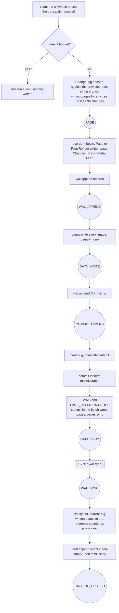
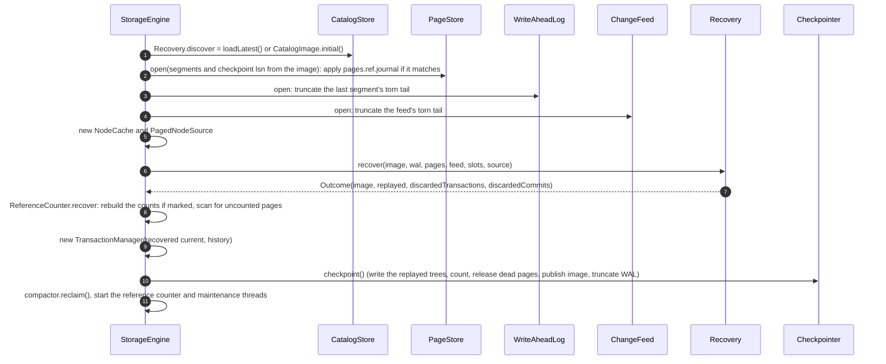

# Write-ahead log, durability and recovery

This document specifies the on-disk write-ahead log byte for byte, the two WAL modes, the two durability levels, the exact ordering of writes and syncs in a commit, the crash points that the test-suite injects, the recovery algorithm, and checkpointing.

A commit logs the keys it changed, not the pages it changed. Its new tree nodes stay in memory, reachable from the published generation, until a checkpoint writes them to pages. Recovery rebuilds the commits since the last checkpoint by replaying those key changes onto the checkpoint's trees.

Source of truth:

| Concern | File |
|---|---|
| Record types and payload codecs | `engine/src/main/java/io/hstore/engine/wal/WalRecord.java` |
| Segment files, framing, torn-tail handling | `engine/src/main/java/io/hstore/engine/wal/WriteAheadLog.java` |
| What a commit writes and in which order | `engine/src/main/java/io/hstore/engine/txn/TransactionManager.java` (`append`, `makeDurable`, `spill`) |
| Key changes logged by a commit | `engine/src/main/java/io/hstore/engine/txn/ChangeLog.java` |
| Crash points | `engine/src/main/java/io/hstore/engine/txn/CrashPoint.java` |
| Recovery | `engine/src/main/java/io/hstore/engine/maintenance/Recovery.java` |
| Checkpoints | `engine/src/main/java/io/hstore/engine/maintenance/Checkpointer.java`, `tree/Materializer.java`, `catalog/CatalogStore.java` |
| Reference counts | `engine/src/main/java/io/hstore/engine/maintenance/ReferenceCounter.java`, `page/ReferenceCounts.java`, `page/ReferenceJournal.java` |
| Byte encodings | `engine/src/main/java/io/hstore/engine/page/ByteCursor.java`, `tree/Ref.java`, `tree/Summary.java` |
| Crash test matrix | `engine/src/test/java/io/hstore/engine/CrashRecoveryTest.java`, `DeferredWritesTest.java` |

Related: [transactions](transactions.md), [change feed](../storage/change-feed.md), [pages](../storage/pages.md), [catalog and generations](../storage/catalog-and-generations.md), [maintenance](../storage/maintenance.md), [configuration](../operations/configuration.md).

## 1. Directory layout

`StorageEngine` places every durable structure under the database directory:

```text
<db>/
  FORMAT                         properties: format=8, page-size=<bytes>
  LOCK                           exclusive FileLock held while open
  catalog/manifest               name of the current catalog image file
  catalog/generations/%016x.cat  checkpointed catalog images (3 newest retained)
  data/segments/*.seg            page segments (see pages.md)
  data/segments/pages.dir        page directory: the address of every page number (see pages.md)
  data/segments/pages.ref        reference count of every page number, as of the last checkpoint
  data/segments/pages.ref.journal  counts and released entries of a checkpoint, empty once applied
  wal/segments/%016x.wal         WAL segments, named by their starting LSN in hex
  feed/%016x.feed                change feed segments, named by global byte position (see change-feed.md)
```

## 2. Primitive encodings

All fixed-width integers are **little-endian** (`ByteCursor` uses `JAVA_INT_UNALIGNED` / `JAVA_LONG_UNALIGNED` with `ByteOrder.LITTLE_ENDIAN`).

| Notation | Encoding |
|---|---|
| `u8` | one byte |
| `i32`, `i64` | little-endian two's complement |
| `varlong` | unsigned LEB128: 7 data bits per byte, low group first, high bit = continuation, at most 10 bytes |
| `varint` | `varlong` of the int interpreted as **unsigned** 32-bit (`Integer.toUnsignedLong`) |
| `svarlong` | zigzag (`(v << 1) ^ (v >> 63)`) then `varlong` |
| `blob` | `varint` length, then that many bytes |
| `string` | `blob` of UTF-8 |
| `Ref` | `u8 tag`. Tag `0` is the empty tree and ends the encoding. Tag `1` is followed by `i64 pageId`, `varlong units` (the image size in 64-byte units, at most 3 bytes) and a `Summary`. Tag `2` is an inline tree, which only appears for a nested tree, inside a catalog record or a nested tree change of a `Changes` record, never for a slot root ([pages.md](../storage/pages.md#payload-treenodecodecjava)) |
| `Summary` | `varlong count`; if `count == 0` nothing else; otherwise `svarlong min`, `varlong (max - min)`, `svarlong weightSum`, `svarlong weightMin`, `svarlong weightMax`, `svarlong timeMin`, `svarlong timeMax`, `i64 roleBits`, `i64 fingerprint` (at most `Summary.MAX_ENCODED_BYTES = 96`) |

## 3. Segments and frames

The WAL is a single logical byte stream addressed by **LSN** (absolute byte offset since the log was created). It is cut into segment files named `%016x.wal` after the LSN of their first byte. `EngineOptions.walSegmentBytes` defaults to 64 MiB.

Every record is one frame with a 25-byte header (`WriteAheadLog.HEADER = 25`):

```text
offset  size  field
0       4     i32  payload length P (0 <= P <= 2^30)
4       4     i32  CRC-32C over bytes [8, 25 + P)
8       8     i64  LSN of this frame (must equal its position in the stream)
16      1     u8   record type (1..10)
17      8     i64  transaction id
25      P     payload (per type, section 4)
```

The checksum covers the LSN, type, transaction id and payload. Embedding the LSN means that stale bytes left behind by an earlier, longer file (or a frame from a different position) can never validate.

**Append.** `append(List<WalRecord>)` encodes the whole list into one buffer and issues it as one positional write under the WAL lock, so the records of one call are contiguous. Before writing, the log rolls to a new segment if the active segment is non-empty and the batch would push it past `walSegmentBytes`. A batch is never split across segments; a batch larger than a segment gets an oversized segment of its own. Rolling `force(true)`s and closes the previous segment, creates the new file, and forces the `wal/segments` directory (`syncDirectory`; filesystems that cannot open a directory for sync are logged at `DEBUG` and skipped) so that the new segment's directory entry survives a power loss.

**Sync.** `sync()` calls `FileChannel.force(false)` on the active segment if anything was written since the last sync (`dirty`). Rolled segments were forced when they were closed, so one call makes the entire log durable.

**Open.** `restore()` lists `*.wal`, scans only the **last** segment frame by frame, truncates it to the end of the last valid frame and forces it. Recovery therefore always appends after a clean frame boundary. The scan checks each frame's header and CRC-32C but doesn't decode the records, and a reader reuses one header and one body buffer, growing the body only for a larger frame, so opening doesn't allocate per frame.

**Read.** `read(from)` iterates frames starting at LSN `from` across segments. When fewer than 25 header bytes remain in a segment, the reader treats it as the clean end of that segment and continues with the next one. A *damaged* frame is one whose length is out of range, whose embedded LSN differs from the expected one, whose body is short, or whose CRC does not match. What happens next depends on where it is:

| Damaged frame in | Result |
|---|---|
| the tail segment (no later segment exists) | reading stops; everything from that frame on is treated as never written (torn-tail rule) |
| any earlier segment | `HStoreException.CorruptLog` (code `CORRUPT_LOG`, not retryable): `write-ahead log segment X.wal is damaged (reason) but later segments exist; replay would silently drop committed transactions` |

Only the tail can legitimately be torn, because every earlier segment was forced when the log rolled past it. Damage anywhere else means data loss or tampering, and the engine refuses to open rather than recover a silently shortened history.

**Truncate.** `truncateBefore(lsn)` deletes every segment whose *successor* starts at or before `lsn`, never the active segment. The segment containing `lsn` is always kept.

## 4. Record types

`WalRecord` is a sealed interface; `typeOf` and `readPayload` define the wire ids.

| Type | Record | Payload layout | Emitted by |
|---|---|---|---|
| 1 | `Begin(txnId, branch, baseGeneration)` | `varint branch`, `varlong baseGeneration` | first record of every commit (`append`) |
| 2 | `Page(txnId, pageId, address, image)` | `i64 pageId`, `i64 address`, `blob image` | `PAGE_IMAGES` mode, one per page written before the commit point: spilled pages, and trees a `Changes` record logs by reference |
| 3 | `Root(txnId, branch, slot, root)` | `varint branch`, `varint slot`, `Ref root` | not written since format 7. The decoder still reads it and recovery still applies it |
| 4 | `BranchMeta(txnId, id, name, parent, baseGeneration, createdAt, state)` | `varint id`, `string name`, `varint parent`, `varlong baseGeneration`, `varlong createdAt`, `u8 state` (`ACTIVE=0`, `MERGED=1`, `DROPPED=2`) | `createBranch`, `closeBranch` |
| 5 | `Feed(txnId, payload)` | `blob` containing a `FeedCodec`-encoded `CommitEvent` | commits with at least one member or slot change |
| 6 | `Commit(txnId, generation, wallTime, nextAtom, nextTxn)` | `varlong generation`, `varlong wallTime`, `varlong nextAtom`, `varlong nextTxn` | last record of every commit, appended separately |
| 7 | `Abort(txnId)` | empty | `Transaction.abort()` via `TransactionManager.logAbort`, only for transactions that spilled pages (the only case in which a transaction has WAL records before its commit) |
| 8 | `Checkpoint(0, generation, lsn)` | `varlong generation`, `varlong lsn` | `Checkpointer`, transaction id is always 0 |
| 9 | `PageRef(txnId, pageId, address, length, checksum)` | `i64 pageId`, `i64 address` (a packed `PageAddress`), `varint length`, `i32 checksum` (CRC-32C of the page image's first `length` bytes) | `PAGE_REFERENCES` mode, for the same pages as `Page` |
| 10 | `Changes(txnId, branch, payload)` | `varint branch`, `blob payload` (below) | every commit except branch creation and closing, after its `Begin` and page records |

Pages a checkpoint writes are never logged. The checkpoint syncs them before it publishes the catalog image that points at them (section 9).

### The `Changes` payload

`ChangeLog.encode(before, after, ...)` compares the branch's root vector in the generation the commit builds on with the one it publishes. A slot is listed when `Ref.same(before, after)` is false, in ascending slot order:

```text
payload     := varint slotCount | (varint slotId | treeChange)*
treeChange  := u8 2                                  UNCHANGED: keep the base tree (nested trees only)
             | u8 1 | Ref                            ROOT: the tree is this reference
             | u8 0 | varint n | delta*n             DELTA: apply n key changes to the base tree
delta       := i64 key | u8 0                        REMOVE
             | i64 key | u8 1 | blob value | treeChange*   PUT
```

* `ROOT` is written when the new root is not an in-memory node: a stored reference, an inline one or the empty tree, encoded with `Ref.write`.
* `DELTA` lists the keys `TreeDiff` finds between the two trees, in key order. A `PUT` value is the tree codec's encoding of a one-entry leaf holding the key and the value, with every nested tree reference replaced by an empty one. One `treeChange` per nested reference follows, in `forEachRef` order, each relative to the nested tree at the same position in the value it replaces. The base is the empty tree when there was no value or the nested schema at that position differs. An edge record therefore logs its changed members, not its whole member tree.
* A tree whose entry count moved by more than 4,096 (`ChangeLog.MAX_DELTA`), or whose diff has more than 4,096 entries, is written to pages at commit and logged as `ROOT` with the stored reference. Its pages get `Page` or `PageRef` records in the same commit, like spilled pages. A large bulk load ends up here.

`ChangeLog.apply` does the reverse: it reads each slot's change and applies it to the slot's tree in the base root vector, building nested trees the same way.

Frame sizes that follow directly from the layouts (25-byte header included):

| Record | Bytes |
|---|---|
| `PageRef` with `128 <= length < 16384` | 25 + 8 + 8 + 2 + 4 = **47** |
| `PageRef` with `length = 16384` | 25 + 8 + 8 + 3 + 4 = **48** |
| `Page` with image length `L` (128 <= L < 16384) | 25 + 8 + 8 + 2 + L = **43 + L** |
| `Commit` | 25 + 4 varlongs; with a 6-byte millisecond wall clock typically 34 to 42 |
| `Changes` | 25 + `varint branch` + `blob payload`. Each changed key costs 9 bytes plus, for a `PUT`, its encoded value and nested tree changes; each changed slot adds its id and a kind byte |
| `Checkpoint` | 25 + 2 varlongs |

### Example frame

A `PageRef` for the (arbitrary) page id `0x0000000300000101`, stored at unit 1234 of segment 1, image length 3,912 (62 units), checksum `0x1A2B3C4D`, transaction 77, at LSN 4096. The payload is 8 + 8 + 2 + 4 = 22 bytes, so the frame is 47 bytes and the next frame starts at LSN 4143:

```text
16 00 00 00              payload length 22
xx xx xx xx              CRC-32C of frame bytes [8, 47)
00 10 00 00 00 00 00 00  LSN 4096
09                       type 9 (PageRef)
4d 00 00 00 00 00 00 00  txn 77
01 01 00 00 03 00 00 00  pageId (i64 LE)
3e 00 d2 04 00 01 00 00  address (i64 LE): segment 1, offset 1234, 62 units
c8 1e                    varint 3912 (0x0F48): low 7 bits 0x48 | 0x80, then 0x1E
4d 3c 2b 1a              checksum (i32 LE)
```

## 5. What one commit writes

Before it takes the commit lock, a committing transaction checks the write buffer (`awaitRoom`, see [maintenance](../storage/maintenance.md#the-write-buffer)). `TransactionManager.append` then runs inside the commit lock. For a commit of transaction `t` producing generation `g = head.id + 1`:



The published generation's roots point at in-memory nodes (`Ref.Pending`). They stay that way until a checkpoint writes them (section 9), so an ordinary commit writes no pages and its only data on disk is its WAL records.

Circles are `CrashPoint`s, reached through `storage.faults().reach(point)` exactly where drawn. The enum order is the order of the write path:

```text
PAGE < WAL_APPEND < DATA_WRITE < COMMIT_APPEND < DATA_SYNC < WAL_SYNC < CATALOG_PUBLISH
```

The `Commit` record is appended in a separate call **after** any data pages were written. It is the atomic commit point: a transaction is part of the recovered state if and only if its `Commit` frame is valid in the recovered log and the durability-prefix rule (section 8) admits it. Consequently a crash at any point `>= COMMIT_APPEND` that preserves the operating system's page cache recovers the commit, and a crash at any point `< COMMIT_APPEND` recovers the prior state.

Spilled subtrees (`TransactionManager.spill`, only for bulk loads) are handled earlier, outside the commit lock: the page images are written to their segments **first**, then the `Page`/`PageRef` records are appended, carrying the transaction id but no `Begin`. Recovery attaches them to the transaction's body by id. The data-before-log order matters for checkpoints, which can run while a spill is in progress. A checkpoint's LSN is the end of a commit that was already published when the checkpoint started, and the checkpoint syncs pages and the page directory after that (section 9). Every spill record below that LSN was therefore appended after its page was written and its directory entry set, and both are durable before `truncateBefore` drops the record. If the transaction is aborted, `WalRecord.Abort` follows the spill records and its pages are marked dead for the next checkpoint to release ([maintenance](../storage/maintenance.md#reference-counts)).

## 6. WAL modes

`EngineOptions.walMode`, default `PAGE_REFERENCES` (`WalMode`).

### PAGE_IMAGES

Every page a commit writes is logged in full (`Page`). At commit (`SYNC`) only the WAL is forced; data segments are forced at the next checkpoint (`Checkpointer` calls `pages.checkpoint()` before publishing the catalog image). Recovery rewrites every logged image into its segment (`redo`), so those pages may be arbitrarily stale or torn at crash time.

### PAGE_REFERENCES

Every page a commit writes is logged as a 47 or 48 byte `PageRef` holding its id, address, length and CRC-32C. The image itself lives only in the data segment. This is safe because of two invariants:

1. **Pages are never overwritten in place while reachable.** The tree is copy-on-write: new versions of changed nodes, whether a checkpoint or a commit writes them, go to *freshly allocated* `PageId`s, and nothing modifies a page that any generation, pinned snapshot or retained catalog image can reach. Compaction copies live pages to new addresses under the same numbers and only reclaims a segment after a checkpoint has moved the WAL past every record that could reference it ([maintenance](../storage/maintenance.md)). A page number is never handed out twice, and `PageHeader.verify` rejects an image whose stored number differs from the requested one.
2. **Data is forced before the log.** When a commit in the group-commit batch wrote pages, `makeDurable` calls `pages.sync()` (every dirty segment file, `force(false)`) and only then `wal.sync()`. When the commit's `Commit` frame is durable, so is every page it references. A batch whose commits wrote no pages syncs only the WAL.

Invariant 2 alone is not enough: the OS may write the WAL segment back to disk on its own *before* `pages.sync()` runs, and a power failure at that moment leaves a durable `Commit` frame whose pages are missing. That commit was never acknowledged (acknowledgement happens after `WAL_SYNC` and publication). Recovery detects the situation by verifying every `PageRef` (section 8) and discards the commit together with everything after it.

### Write amplification

An ordinary commit writes no pages. Its WAL cost is one `Begin`, one `Changes` record, an optional `Feed` and one `Commit`, and the `Changes` record grows with the keys changed, not with tree height. The pages come later: a checkpoint writes every node changed since the previous checkpoint once, however many commits changed it in between. A leaf that many commits touched is written once per checkpoint, not once per commit, and so are the branch nodes above it. `DeferredWritesTest.smallCommitsWriteNoPagesAndACheckpointWritesEachNodeOnce` checks that 300 single-insert commits write no pages and that the checkpoint after them writes fewer than 60.

The WAL modes differ only for the pages a commit writes itself: spills and trees logged by reference. Let a commit write `N` such pages with mean image length `L` (images are `PageHeader.SIZE = 80` bytes plus the encoded node, at most the page size `P`; `NodeCodec.encode` returns a slice of exactly that length). Ignoring the per-commit records:

| | `PAGE_IMAGES` | `PAGE_REFERENCES` |
|---|---|---|
| WAL bytes | `N (43 + L)` | `47 N` |
| Data segment bytes | `N L` | `N L` |
| Total bytes written per commit | `N (2L + 43)` | `N (L + 47)` |
| Forced at commit (`SYNC`) | WAL only | dirty data segments, then WAL |
| Forced later | data segments and the page directory at checkpoint | the page directory at checkpoint |
| Recovery source of page bytes | WAL | data segments (verified) |

Worked numbers for the default page size `P = 16 KiB` and `N = 12`:

| `L` | `PAGE_IMAGES` total | `PAGE_REFERENCES` total | Ratio |
|---|---|---|---|
| 16,384 (full pages) | 12 x (32,768 + 44) = 393,744 B | 12 x (16,384 + 48) = 197,184 B | 2.00x |
| 8,000 | 12 x 16,043 = 192,516 B | 12 x 8,047 = 96,564 B | 1.99x |
| 1,024 | 12 x 2,091 = 25,092 B | 12 x 1,071 = 12,852 B | 1.95x |

For those pages `PAGE_REFERENCES` halves device write volume and shrinks the log by roughly `L / 47`. The price is a second `fsync` target for a group-commit batch that wrote pages (the dirty segment files), amortised across the batch like the WAL sync. Pages a checkpoint writes cost the same in both modes: they are written once and synced by the checkpoint.

## 7. Durability levels

`EngineOptions.durability`, default `SYNC` (`Durability`).

| Mode | Commit acknowledged after | Data at risk on power loss | Never possible |
|---|---|---|---|
| `SYNC` + `PAGE_REFERENCES` | data `fsync` (only if the batch wrote pages), WAL `fsync`, publication | nothing acknowledged | a recovered state that mixes a commit's effects |
| `SYNC` + `PAGE_IMAGES` | WAL `fsync`, publication | nothing acknowledged | same |
| `ASYNC` (either mode) | publication only, no `fsync` | acknowledged commits after the last checkpoint or OS write-back | same; recovery yields a prefix of the commit order |

Under `ASYNC` the group committer still publishes commits strictly in order and readers still see only appended and published generations; only the `fsync` calls are skipped. Process crashes (as opposed to power or kernel failures) lose nothing in either mode, because the OS page cache survives the process.

## 8. Recovery

`StorageEngine` constructor:



`Recovery.recover(checkpoint, wal, pages, feed, slots, source)`:

1. **Scan.** Read the WAL from `checkpoint.checkpointLsn()` (may throw `CORRUPT_LOG`, section 3). `Commit` frames are collected in log order; `Abort` drops the transaction's buffered spill records; `Checkpoint` is ignored; every other record is buffered in `pending[txnId]`.
2. **Filter.** For each commit in log order, remove its body from `pending`. Skip it if `commit.generation <= checkpoint.current().id()` (already in the image). Otherwise write the address of every `Page` and `PageRef` in the body (spilled pages and trees logged by reference) back into the page directory (`PageStore.place`), which also moves the directory's next index past that number. Entries written after the last checkpoint may not have reached the disk; this restores them.
3. **Durability prefix.** If any earlier commit was discarded, discard this one too. Otherwise check `intact(body, pages)`: for every `PageRef` in the body, read the page, run `PageHeader.verify(page, pageId)` (magic, format, identity, header checksum), and require `page.byteSize() >= length` and `crc32c(page[0, length)) == checksum`. Any exception or mismatch means the page never reached storage; log a warning once (`durable prefix ends before generation g`) and discard this and every later commit. `Page` records need no verification because they carry their own bytes, protected by the frame CRC.
4. **Redo.** Apply the body's `BranchMeta` records first, then the rest in order. `BranchMeta` inserts or updates the branch: a new `ACTIVE` branch takes its parent's roots, an existing `ACTIVE` branch keeps its own, and a `MERGED` or `DROPPED` branch gets empty roots. `Changes` replays the commit's key changes onto the branch's current roots with `ChangeLog.apply`, under a fresh `WriteScope` for this commit that is frozen afterwards, so the next commit copies these nodes instead of changing them. `Page` writes the image at the address it carries; `Root`, which this build no longer writes, sets one slot root of one branch; `Feed` hands its payload to the change feed as it is (`ChangeFeed.appendEncoded`), which reads only the generation at its start and appends the bytes unless the feed already holds that generation. The payload is the same `FeedCodec` encoding the feed stores, so recovery never decodes the event. Build `Generation(commit.generation, commit.wallTime, commit.txnId, max(nextAtom), max(nextTxn), branches)` and append it to the history.
5. **Seal.** `pages.sync()`; `feed.truncateAfter(recovered generation)` drops feed frames for commits that did not survive (possible under `ASYNC`, or after the prefix rule fired); `feed.sync()`.
6. **Result.** `CatalogImage(recovered generation, history, segments, wal.end(), feed.size())` and `Outcome(image, replayed, discardedTransactions = pending.size(), discardedCommits)`, where `replayed` lists the generations redone, in order, and `history` is the image's history followed by the replayed generations. `discardedTransactions` counts transactions that wrote records but neither a `Commit` nor an `Abort` (crashed mid-commit, or spilled and then lost to a crash before committing or aborting).

The replayed generations live in memory: their trees are pending nodes built on the checkpoint's pages, read through the node cache and source that the constructor creates before recovery. Nothing is written for them until the checkpoint at the end of the open. The reference counts in `pages.ref` describe the checkpointed generation and stay there; that checkpoint counts the generation it writes against it. If `pages.ref` is marked for rebuilding, the counts are first recomputed from the checkpointed generation and the image's history. `ReferenceCounter.recover` then scans the page directory. A page with an address but no count and no death mark was written after the last checkpoint: spilled, written by a commit, written by a checkpoint that never published, or written by a transaction that never committed. Its entry is kept, and the page is handed to the first checkpoint as provisional, which counts it if the generation it writes reaches the page and marks it dead otherwise ([maintenance](../storage/maintenance.md#reference-counts)).

The prefix rule is what makes recovery produce *the state after some prefix of the commit order*. Without it, a durable commit `k+1` whose pages survived could be replayed on top of a lost commit `k`, and its key changes, which apply to `k`'s trees, would expose a mixture.

Recovery is idempotent: it writes nothing to the WAL, `Page` redo rewrites identical bytes, the replayed trees exist only in memory, feed appends are keyed by generation, and the constructor immediately publishes a new checkpoint. A crash during recovery repeats the same work on the next open.

The log line written at the end has the form:

```text
LOG:  [recovery] recovered generation 158: replayed 0 commits from lsn 156,490, discarded 0 unfinished transactions and 0 non-durable commits
```

## 9. Checkpoints

A checkpoint writes the trees of one published generation to pages and makes that generation the starting point of the next recovery. `Checkpointer.checkpoint()` takes the commit lock for one short step only (step 9), so commits keep running while it writes and syncs.

1. **Target.** `g = transactions.current()`, the newest published generation, and a new `Epoch` for this attempt.
2. **Write the pages.** A `Materializer` walks every branch's roots in `g` and writes each pending node it reaches, children first: `pages.allocate`, `pages.write`, then the frozen node is admitted to the node cache and the in-memory node is stamped with its stored reference and the epoch. A node stamped by the last published epoch was written by the previous checkpoint, or by a commit that logged its tree by reference, so its stored reference is reused and the subtree below it is not visited. The images carry `g` as their creation epoch. The result is `g` with every root stored.
3. `CHECKPOINT_PAGES`, then `pages.checkpoint()` fsyncs every dirty segment file and forces the page directory. If anything up to here fails, the pages written so far are handed to the reference counter as discarded, so a later checkpoint releases them.
4. The reference counter is paused (`ReferenceCounter.pause`) until step 11 is done. If the previous checkpoint's journal was never applied, it is applied now (`settleJournal`).
5. **LSN.** `lsn` is the WAL position just after `g`'s `Commit` record (`TransactionManager.commitEnd`), or the previous checkpoint's LSN when `g` is the generation that checkpoint already wrote. Commits published after `g` lie above `lsn` and stay in the log.
6. **Count.** `ReferenceCounter.checkpointed(previous, written)` compares the previously checkpointed generation with the one just written and updates the counts ([maintenance](../storage/maintenance.md#reference-counts)). Dead pages that no retained or pinned generation can reach are then released ([maintenance](../storage/maintenance.md#releasing-pages)).
7. `pages.checkpoint()` again, then `pages.journal(lsn)`: every count changed since the last checkpoint and every released directory entry, as absolute values, go to `pages.ref.journal` behind a header holding `lsn` and with a CRC-32C at the end, and the file is forced. `feed.sync()` (forces the active feed segment; earlier feed segments were forced when the feed rolled).
8. `CHECKPOINT_CATALOG`, then `catalog.publish(CatalogImage(written g, List.of(), segments, lsn, feed.size()))`. Retained history is not written into the image. The image is framed as `i32 magic 0x54414348`, `i32 crc32c(payload)`, `i64 length`, payload; written to `generations/%016x.cat.tmp`, forced, atomically renamed, the directory forced; then `manifest` is rewritten the same way. The three newest `.cat` files are kept; `loadLatest()` falls back to the newest valid file if the manifest is missing or names a corrupt file.
9. `TransactionManager.checkpointed(written g, epoch)` publishes the epoch and forgets the commit positions of generations before `g`. Then, holding the commit lock and with the group committer drained, it swaps the written pages into the head generation: every node there that this checkpoint wrote is replaced with its stored reference, and parents that only changed because of that are copied (`Materializer.rebound`). Head, `current` and head's history entry become the rebound generation. Last, it recounts the write buffer and wakes commits that were waiting for room.
10. `wal.append(Checkpoint(0, g, lsn))`, `wal.sync()`, `wal.truncateBefore(lsn)`.
11. `CHECKPOINT_JOURNAL`, then `pages.applyJournal()` writes the journaled values into `pages.ref` and `pages.dir`, forces both and truncates the journal to zero bytes. The checkpoint remembers `lsn` and resumes the counter.

Because the journal holds absolute values, applying it twice gives the same files. If the process dies after step 8 but before step 11 is finished, the next open finds a journal whose LSN matches the published catalog and applies it again. If it dies before step 8, the journal's LSN doesn't match and it is ignored: `pages.ref` and `pages.dir` were not touched, so they still match the previous catalog, and the pages this checkpoint wrote have addresses but no counts, so the next open hands them to its first checkpoint, which finds nothing that reaches them and marks them dead. If step 10 or 11 fails and the engine keeps running, the next checkpoint applies the old journal before writing a new one, and a failed step 8 marks `pages.ref` for rebuilding. `ReferenceCountTest` crashes at `CHECKPOINT_CATALOG` and at `CHECKPOINT_JOURNAL` and checks the counts after reopening, including after a checkpoint that failed at step 11 and a next one that crashed before step 8. `DeferredWritesTest` crashes a checkpoint at `CHECKPOINT_PAGES`, `CHECKPOINT_CATALOG` and `CHECKPOINT_JOURNAL` while another thread keeps committing, and checks that every acknowledged commit is there after reopening and that the counts match.

The checkpoint LSN is the end of `g`'s `Commit` record, not the position of the `Checkpoint` record. The next recovery starts there, replays the commits published after `g`, and skips the `Checkpoint` record when it reaches it. Triggers:

| Trigger | Where |
|---|---|
| Every open, right after recovery | `StorageEngine` constructor |
| The write buffer holds more than half of `writeBufferBytes` (default 64 MiB); WAL or page writes grew by more than `checkpointWalBytes` (default 256 MiB) since the last checkpoint; or more than 1 048 576 reference counts changed. Checked every `maintenanceInterval` (default 500 ms), or sooner when a commit finds the write buffer full | `StorageEngine.maintain` |
| Compaction, before choosing victims and again after moving pages, before deleting segments | `StorageEngine.compact` |
| `verifyReferences()`, before it compares the counts | `StorageEngine.verifyReferences` |
| Clean shutdown | `StorageEngine.close` |
| On demand | `StorageEngine.checkpoint()`, HQL `CHECKPOINT` |

After each completed checkpoint, `StorageEngine.timedCheckpoint` logs `checkpoint complete: generation g, lsn n, k wal segments retained, t ms`, runs the registered checkpoint listeners (the semantic plane persists its vector index there, which also advances its feed hold), and finally applies change-feed retention with `feed.retain(current - feedRetention)` (see [change feed retention](../storage/change-feed.md#6-retention-and-holds)).

## 10. What the crash tests prove

`CrashRecoveryTest.recoveryYieldsPriorOrNewStateNeverAMixture` is parameterised over every `WalMode` x every commit-path `CrashPoint`, `PAGE` to `CATALOG_PUBLISH` (2 x 7 = 14 cases). Each case:

1. Commits an ordered edge with 200 members (each a fresh node).
2. Arms a fault injector that throws `CrashPoint.SimulatedCrash` (an `Error`) the first time the chosen point is reached.
3. Begins a transaction that creates 300 more nodes and inserts each at position 0, then commits: the commit must throw `SimulatedCrash`. Crash points up to `COMMIT_APPEND` throw on the committing thread inside `append`; `DATA_SYNC`, `WAL_SYNC` and `CATALOG_PUBLISH` throw on the committer leading the batch (here the committing thread itself), break the pipeline, and are rethrown to every waiting committer by `GroupCommitter.failIfFailed`.
4. `halt()`s the engine (no checkpoint, files closed as after a process crash; the OS page cache is preserved).
5. Reopens, checks the reference counts (`verifyReferences`), and asserts the edge has 200 or 500 members, never anything else; exactly `500` iff `point >= COMMIT_APPEND`; the node count equals the member count; every member has degree 1 (the reverse index agrees with the forward index). It then writes again, reopens, and checks that the post-crash write survived (recovery left the log appendable).

| Crash point | Thread | On disk at crash | `PAGE_IMAGES` | `PAGE_REFERENCES` |
|---|---|---|---|---|
| `PAGE` | committer | nothing for this commit | 200 (prior) | 200 (prior) |
| `WAL_APPEND` | committer | `Begin`, `Changes`, `Feed`; no `Commit` | 200, counted as unfinished | 200, counted as unfinished |
| `DATA_WRITE` | committer | as above; every tree stays under 4,096 changes, so the commit wrote no pages | 200 | 200 |
| `COMMIT_APPEND` | committer | `Commit` frame written, not synced | 500 (new), replayed from `Changes` | 500, same |
| `DATA_SYNC` | commit leader | no data sync (the batch wrote no pages), WAL not synced | 500 | 500 |
| `WAL_SYNC` | commit leader | WAL synced, not published | 500 | 500 |
| `CATALOG_PUBLISH` | commit leader | feed appended (not forced), published to `current` | 500, feed frame kept or re-appended from the `Feed` record | 500, same |

`COMMIT_APPEND` is the instructive row: the client received an error, yet the commit is recovered. This is the standard "commit outcome unknown" case of every database; clients that must know use `TxnOptions.withRequestId(...)` and retry, and the retry returns `DUPLICATE` with the original generation.

`recoveryStopsAtTheFirstCommitWhosePagesAreMissing` covers the power-loss reordering that a process crash cannot produce. With `PAGE_REFERENCES` it commits `durable`, reopens, commits `lost-1` and `lost-2`, each of which creates a node and bulk-loads a 20,000-member edge (the load spills pages, and the commit writes the rest of the tree because it grew by more than 4,096 entries), halts, and truncates the last data segment to one byte short of its size before `lost-2`, so `lost-1`'s last page fails its checksum. Recovery must report `discardedCommits >= 1`, keep `durable`, drop `lost-2` (which itself has intact pages but follows a broken commit), and accept new writes that survive another reopen.

`concurrentCommitsShareDurabilityBarriers` runs 400 concurrent writers and checks that all 400 commits are visible and that `averageGroupCommit >= 1`.
